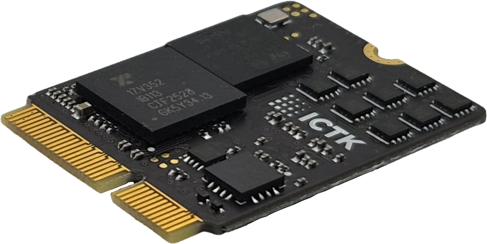

# qTrustVault

ICTK qTrustVault 제품 문서 / Product documentation / 製品ドキュメント

## qTrustVault ME

M.2 2230 E-key HSM (Hardware Security Module) — `IM20001-MRC04-3`

### 데이터 시트 / Datasheet / データシート

| 언어 / Language | 문서 | 개정 / Revision | 상태 / Status |
| --- | --- | --- | --- |
| 한국어 | [qtrust-vault-me-datasheet-kr_v0.4.md](datasheet/qtrust-vault-me-datasheet-kr_v0.4.md) · [docx](datasheet/qtrust-vault-me-datasheet-kr_v0.4.docx) | 0.4 | Draft |
| English | [qtrust-vault-me-datasheet-en_v0.4.md](datasheet/qtrust-vault-me-datasheet-en_v0.4.md) | 0.4 | Draft |
| 日本語 | [qtrust-vault-me-datasheet-jp_v0.4.md](datasheet/qtrust-vault-me-datasheet-jp_v0.4.md) | 0.4 | Draft |

> 이 데이터 시트는 초안(Draft)이며 예고 없이 변경될 수 있습니다.
> This datasheet is a draft and is subject to change without notice.
> 本データシートはドラフトであり、予告なく変更されることがあります。

---

© ICTK Co., Ltd. All rights reserved.
