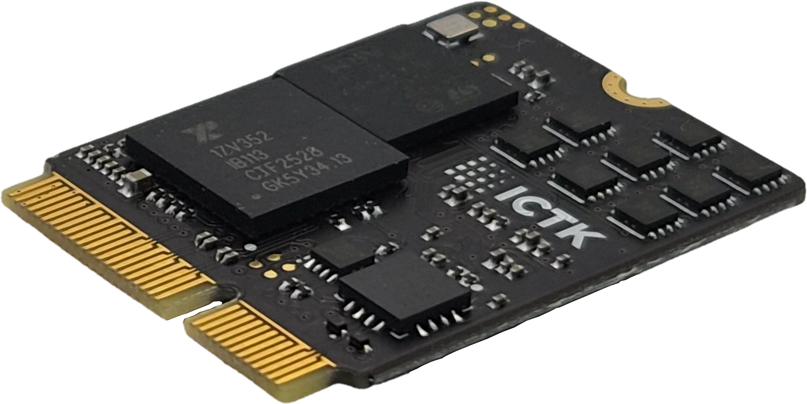
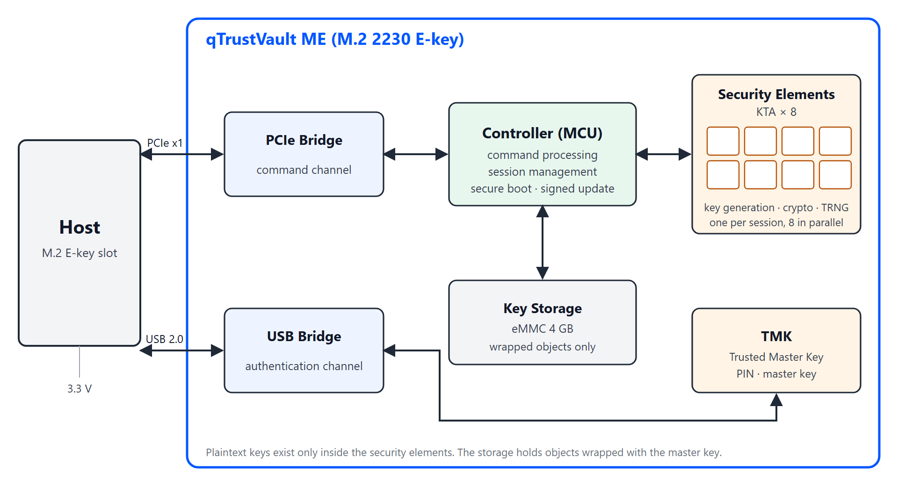
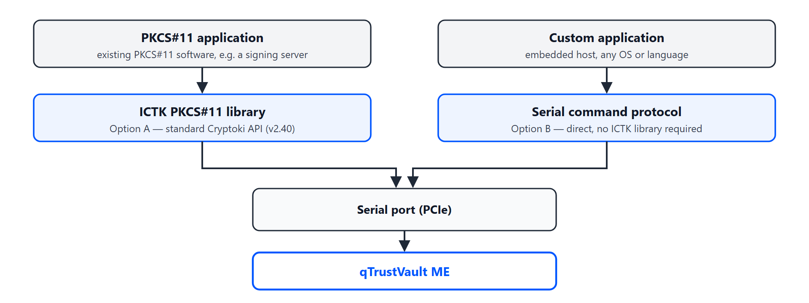

# qTrustVault ME Datasheet

| | |
| --- | --- |
| Product | qTrustVault ME (`IM20001-MRC04-3`) |
| Document | Datasheet (including electrical characteristics) |
| Revision | 0.4, 2026-11-03 |
| Status | **Draft** |
| Hardware | HW 3.1 |
| Publisher | ICTK Co., Ltd. |

---

## 1. Overview

qTrustVault ME is an HSM (Hardware Security Module) in the M.2 2230 E-key form factor.
The module performs key generation, key storage, cryptographic operations and access
control on its own. Installed in a host M.2 E-key slot, it appears as a serial port over
PCIe, and the host sends commands to the device directly using the command protocol.

User keys are generated and used inside the eight KTA (Keyless Trust Anchor) secure
elements on the module, and are kept in on-board storage only in a form wrapped by the
master key. Plaintext keys never leave the KTA.

### 1.1 Features

- **M.2 2230 E-key hardware security module** — single 3.3 V supply, ready to use in a host slot
- **Eight secure elements in parallel** — a dedicated secure element (KTA) per session, up to 8 concurrent sessions
- **Keys never leave the device** — generated and used inside the secure elements, stored only in a form wrapped by the master key
- **Broad algorithm support** — ECDSA · ECDH (P-256, P-384, secp256k1), EdDSA (Ed25519, Ed448), X25519 · X448, AES-128/256 (CBC, CCM, GCM), HMAC · SHA-256/384, HKDF, hardware TRNG
- **Large key storage** — up to 81,920 objects
- **Two ways to integrate** — the standard PKCS#11 (v2.40) library, or direct control through the serial command protocol with no library (see 2.1)
- **Firmware protection** — secure boot with signature verification, updates that accept signed images only, rollback protection
- **Performance** — about 68 ECDSA P-256 signatures per second (8 sessions in parallel, representative measurement in the 8.2 reference host)
- **Operating temperature** −25 to +85 °C

### 1.2 Applications

- Private key protection for servers and gateways — TLS, device certificates, code and document signing
- Device authentication and data encryption for edge and industrial equipment
- Key management for digital asset wallets and blockchain nodes (secp256k1, Ed25519)
- Root and master key custody for key management systems (KMS)
- Firmware and software signing servers

### 1.3 Key Specifications

| Item | Description |
| --- | --- |
| Form factor | M.2 2230, E-key, single 3.3 V supply |
| Host interface | PCIe x1 (seen as serial ports), USB 2.0 Full-Speed |
| Secure elements | 8 KTAs. 8 sessions processed in parallel, a dedicated KTA bound to each session |
| TMK | TMK (Trusted Master Key). 1 secure chip dedicated to login (PIN) authentication and master key storage |
| Key storage | eMMC 5.1 4 GB, up to 81,920 stored objects |
| Cryptography | ECC (P-256, P-384, secp256k1, Ed25519, Ed448, X25519, X448), AES-128/256 (CBC, CCM, GCM), HMAC-SHA-256/384, HKDF, hardware TRNG |
| Firmware protection | Secure boot with signature verification, secure update accepting signed firmware only, rollback protection |
| Host integration | PKCS#11 (v2.40) library, or direct control through the serial command protocol (CBOR payload, CRC-32) |

## 2. Functional Overview

| Function | Host side | Description |
| --- | --- | --- |
| Command channel | PCIe x1 → serial port | Channel for all commands and responses |
| Authentication channel | USB 2.0 | Login (PIN) authentication and master key setup |
| Cryptographic operations | — | 8 KTA secure elements. A dedicated KTA is assigned to each session for parallel processing |
| Key storage | — | 4 GB. Stores only objects wrapped by the master key |

### 2.1 Integration Options

The device receives commands over a serial port on the host. A host uses the device in one of two ways.

| Method | For | Description |
| --- | --- | --- |
| PKCS#11 library | Existing PKCS#11 software | Load the ICTK PKCS#11 (v2.40) library and use the standard API. Provided for Windows (x64 and x86) and Linux (x86_64). See the PKCS#11 Reference Guide |
| Serial command protocol | Embedded hosts, in-house software | Exchange command frames (CBOR payload, CRC-32) directly, with no library. **No operating system or language constraint.** See the Standard Reference Manual |

> **Note — the device does not depend on PKCS#11**
> The PKCS#11 library is **one way** of using the device. The device's own interface is the serial command protocol, and every function is available through that protocol alone, without the library.

## 3. Pin Assignment

### 3.1 Connector

| Item | Value |
| --- | --- |
| Connector | M.2 E-key card edge, 75 pins |
| Key position | E (pins 24 – 31 absent) |

### 3.2 Connected Pins

Directions are given from the module's side. The transmit/receive names of the PCIe differential pairs follow the PCI Express M.2 specification.

| Pin | M.2 signal | Module function | Direction | Level | Notes |
| --- | --- | --- | --- | --- | --- |
| 2, 4, 72, 74 | 3.3V | Main power | Power | 3.3 V | All 4 pins connected |
| 1, 7, 18, 33, 39, 45, 51, 57, 63, 69, 75 | GND | Ground | Power | — | |
| 3 | USB_D+ | USB 2.0 D+ | Bidirectional | USB 2.0 FS |  |
| 5 | USB_D− | USB 2.0 D− | Bidirectional | USB 2.0 FS |  |
| 35 | PETp0 | PCIe lane 0 | Differential | PCIe | |
| 37 | PETn0 | PCIe lane 0 | Differential | PCIe | |
| 41 | PERp0 | PCIe lane 0 | Differential | PCIe | |
| 43 | PERn0 | PCIe lane 0 | Differential | PCIe | |
| 47 | REFCLKp0 | PCIe reference clock 100 MHz | Input | HCSL | |
| 49 | REFCLKn0 | PCIe reference clock 100 MHz | Input | HCSL | |
| 52 | PERST0# | PCIe reset | Input | 3.3 V, active low | |
| 53 | CLKREQ0# | Reference clock request | Output | 3.3 V, open-drain, active low | |

### 3.3 No-Connect Pins

The pins below are not connected inside the module. Their state on the host side does not affect operation.

| Group | Pins |
| --- | --- |
| SDIO (odd 9 – 23) | SDIO_CLK, SDIO_CMD, SDIO_DATA0 – 3, SDIO_WAKE#, SDIO_RESET# |
| LED | 6 (LED#1), 16 (LED#2) |
| PCM / I2S | 8, 10, 12, 14 |
| UART | 20 (UART_WAKE#), 22 (UART_RXD), 32 (UART_TXD), 34 (UART_CTS), 36 (UART_RTS) |
| Vendor defined | 38, 40, 42 |
| COEX | 44, 46, 48 |
| Other sideband | 50 (SUSCLK), 54 (W_DISABLE#2), 55 (PEWAKE0#), 56 (W_DISABLE#1), 58 (I2C_SDA), 60 (I2C_SCL), 62 (ALERT#), 64 (RESERVED) |
| PCIe lane 1 | 59, 61 (PETp1/n1), 65, 67 (PERp1/n1), 71, 73 (REFCLKp1/n1) |
| UIM / lane 1 sideband | 66, 68, 70 |

> **Note — PCIe wake**
> PEWAKE0# is not connected, so the module does not generate PCIe wake events.

## 4. Electrical Characteristics

### 4.1 Absolute Maximum Ratings

Conditions beyond these values may cause permanent damage. Operation at these values is not guaranteed.

| Parameter | Symbol | Min | Max | Unit |
| --- | --- | --- | --- | --- |
| Supply voltage | V3P3 | −0.3 | 3.6 | V |
| Signal pin input voltage (PERST0#, CLKREQ0#) | VIN | −0.3 | V3P3 + 0.3 | V |
| Storage temperature | TSTG | −40 | +85 | °C |

### 4.2 Recommended Operating Conditions

| Parameter | Symbol | Min | Typ | Max | Unit | Notes |
| --- | --- | --- | --- | --- | --- | --- |
| Supply voltage | V3P3 | 3.135 | 3.3 | 3.465 | V | 3.3 V ±5 %, including load variation |
| Operating temperature (ambient) | TA | −25 | 25 | +85 | °C | |
| Input high level (PERST0#) | VIH | 2.0 | — | V3P3 | V | |
| Input low level (PERST0#) | VIL | 0 | — | 0.8 | V | |

### 4.3 Power Consumption

| State | Condition | Typ | Max | Unit |
| --- | --- | --- | --- | --- |
| Idle | PCIe link up, no commands | 250 | — | mA |
| Active (single session) | Continuous ECDSA P-256 signing | 300 | — | mA |
| Active (8 sessions in parallel) | Continuous ECDSA P-256 signing | 320 | 450 | mA |
| Power (idle) | V3P3 = 3.3 V | 0.83 | — | W |
| Power (active) | V3P3 = 3.3 V, 8 sessions in parallel | 1.05 | 1.5 | W |

> **Note — Measurement conditions**
> Values are the 3.3 V input current of the whole module (PCIe bridge, MCU, secure elements and eMMC included). Typical values are representative (Typ.) and not guaranteed. Maximum values are design limits with margin over the measured maximum. The supply must stay within the recommended operating voltage range at maximum current.

### 4.4 Power Supervision & Reset

| Parameter | Min | Typ | Max | Unit | Notes |
| --- | --- | --- | --- | --- | --- |
| Undervoltage reset threshold | 2.877 | 2.9 | 2.923 | V | TA = 25 °C. Reset is held while the supply is below this value |
| Reset release to command ready | — | 1,300 | 2,500 | ms | Includes firmware signature verification and secure element start-up. See 8.3 |

### 4.5 PCIe Interface

| Item | Value |
| --- | --- |
| Standard | PCI Express 2.0, Gen 1 (2.5 GT/s) |
| Lanes | x1 (lane 0) |
| Reference clock | 100 MHz supplied by the host (REFCLKp0/n0) |
| Device | Exar XR17V352, 2-channel UART bridge |
| Seen by the host | 2 serial ports (channel 0, channel 1) |
| Wake | Not supported (PEWAKE0# not connected) |
| Link power management (ASPM) | Not supported. ASPM must be disabled for this slot on the host (see 11) |

> **Note — PCIe link power management**
> Per the manufacturer's errata, the PCIe bridge (XR17V352) can malfunction in the
> ASPM L1 or L0s & L1 state. The host may then fail to boot or hang during
> communication. The manufacturer's workaround is to disable ASPM in the BIOS.
> Source: MaxLinear XR17V35x Errata 202ER01 (https://www.maxlinear.com/Document/index?id=21149&languageid=1033&type=Errata&partnumber=XR17V352)

### 4.6 USB Interface

| Item | Value |
| --- | --- |
| Standard | USB 2.0 Full-Speed (12 Mbps) |
| Device | Microchip MCP2221A, USB–I2C/UART bridge |
| Purpose | Host access to the TMK (login, master key setup) |
| VBUS | Not used (the module is powered from the 3.3V pins) |

### 4.7 Status Indicator

| Item | Value |
| --- | --- |
| On-board LEDs | 2 (Green, Red) |
| Green LED | XR17V352 PCIe bridge power good. On when the bridge is properly powered |
| Red LED | qTrustVault ME operation monitor. On during initialization after power-up and off once normal operation begins. Stays on if the device halts on an internal fault |

The M.2 LED#1 and LED#2 pins are not used. Indication is given by the on-board LEDs only.

## 5. Host Serial Link

Open the serial port provided by the PCIe bridge with the settings below. The device-side settings are fixed,
and the host side must match them.

| Parameter | Value | Notes |
| --- | --- | --- |
| Baud rate | 6,750,000 bps | |
| Frame | 8-E-1 | 8 data bits, even parity, 1 stop bit |
| Flow control | RTS / CTS hardware | **Required**. Receive overrun occurs without it |
| Theoretical max throughput | approx. 613.6 kB/s | 11 bits per byte. Response direction (device → host) |
| Request reception | Per frame | While receiving a frame, the device paces the host transmission with RTS |
| Maximum frame | 2,070 B | Payload up to 2,048 B |
| Integrity | CRC-32 (MPEG-2) | |
| Response order | Out of order | Matched by REQUEST_ID |

> **Note — Protocol specification**
> The packet format, session and command specifications follow the standard reference manual.

## 6. Security Features

### 6.1 Key Protection Model

| Item | Description |
| --- | --- |
| Key generation | TRNG inside the KTA |
| Key storage | Wrapped with the master key (AES-GCM), then written to storage |
| Plaintext keys | Restored inside the KTA only for the operation, erased afterwards |
| Master key | No path exports it from the device |
| Copying the storage medium | Yields only wrapped ciphertext. Cannot be restored on another device |
| Key export | EXTRACTABLE keys only, wrapped with a KEK specified by the host |

### 6.2 Mechanisms

| Category | Supported |
| --- | --- |
| Key generation | AES, Generic Secret, EC key pair, Edwards key pair, Montgomery key pair |
| Symmetric encryption / decryption | AES-CBC, AES-CCM, AES-GCM |
| Signing / verification | ECDSA (pre-hashed, SHA-256, SHA-384), EdDSA |
| Message authentication | HMAC-SHA256, HMAC-SHA384 |
| Key agreement / derivation | ECDH, SHA-256/384 derivation, HKDF-SHA256/384 |
| Hash | SHA-256, SHA-384 |
| Random numbers | TRNG, up to 32 B per call |
| Key wrapping | AES-CBC / CCM / GCM |
| Certificate storage | Stores externally issued certificates, wrapped (body up to 1,184 B) |

### 6.3 Curves & Key Sizes

| Standard | Key size | Use |
| --- | --- | --- |
| NIST P-256 | 256 bits | ECDSA signing, ECDH |
| NIST P-384 | 384 bits | ECDSA signing, ECDH |
| secp256k1 | 256 bits | ECDSA sign/verify, ECDH (key agreement) |
| Ed25519 | 256 bits | EdDSA signing |
| Ed448 | 456 bits | EdDSA signing |
| X25519 | 256 bits | Key agreement |
| X448 | 448 bits | Key agreement |
| AES-128 | 128 bits | Symmetric encryption / decryption, key wrapping |
| AES-256 | 256 bits | Symmetric encryption / decryption, key wrapping |

> **Note — ECDSA signature format**
> ECDSA signatures are raw r||s, not DER encoded: 64 B for 256-bit curves (P-256, secp256k1) and 96 B for P-384.
> secp256k1 signatures are not low-S normalised and carry no recovery id (v). An integration that requires low-S and v, such as Bitcoin or Ethereum, must convert s to n-s on the host and derive v itself. This device's verify accepts both s and n-s.

### 6.4 Firmware Protection

| Item | Description |
| --- | --- |
| Secure boot | Firmware signature (ECDSA P-256 / SHA-256) verified at every boot |
| Firmware update | Only images with a verified signature are installed. The previous firmware is kept if installation fails |
| Rollback protection | Images with a lower security counter are not installed |
| Debug access | On production units, reading internal memory through the debug port is blocked |

## 7. Capacity

| Item | Value |
| --- | --- |
| Maximum concurrent sessions | 8 (equal to the number of KTAs) |
| Session objects (device-wide total) | 64 |
| Maximum stored objects | 81,920 (20,480 each of public keys, private keys, secret keys and certificates) |
| Object slot size | 16,384 B |
| Storage reserved for objects | 1,342,177,280 B (1,280 MB) |
| Object label / ID | up to 32 B / 4 B |
| Symmetric encryption / decryption data | up to 1,024 B per call |
| Message to sign | up to 1,024 B per call |
| Hash input | up to 1,024 B per call |
| Certificate body | up to 1,184 B |

## 8. Performance

Performance is given in three parts. 8.1 is the processing performance of the device itself; 8.2 is end-to-end performance measured in the ICTK reference host environment; 8.3 is the startup time from power-up to accepting commands.

### 8.1 Device Performance

| Operation | Input | Time per operation (ms, Typ.) | Operations per second (ops/s, Typ.) |
| --- | --- | --- | --- |
| ECDSA P-256 sign | 32 B | 29.6 | 34 |
| ECDSA P-256 verify | 32 B | 29.7 | 34 |
| ECDSA P-384 sign | 48 B | 48.6 | 21 |
| ECDSA P-384 verify | 48 B | 50.8 | 20 |
| EdDSA Ed25519 sign | 32 B | 37.2 | 27 |
| EdDSA Ed25519 verify | 32 B | 36.7 | 27 |
| EdDSA Ed448 sign | 32 B | 61.8 | 16 |
| EdDSA Ed448 verify | 32 B | 63.3 | 16 |
| ECDH P-256 key agreement | — | 25.1 | 40 |
| ECDH P-384 key agreement | — | 47.6 | 21 |
| X25519 key agreement | — | 28.4 | 35 |
| X448 key agreement | — | 50.6 | 20 |
| HKDF-SHA256 | 32 B output | 17.5 | 57 |
| HMAC-SHA256 | 16 B | 19.8 | 51 |
| HMAC-SHA256 | 256 B | 20.5 | 49 |
| HMAC-SHA256 | 1,024 B | 22.8 | 44 |
| HMAC-SHA384 | 16 B | 21.7 | 46 |
| HMAC-SHA384 | 256 B | 22.4 | 45 |
| HMAC-SHA384 | 1,024 B | 26.7 | 37 |
| AES-256-GCM encrypt | 16 B | 28.4 | 35 |
| AES-256-GCM encrypt | 256 B | 29.8 | 34 |
| AES-256-GCM encrypt | 1,024 B | 35.2 | 28 |
| AES-256-GCM decrypt | 16 B | 28.7 | 35 |
| AES-256-GCM decrypt | 256 B | 30.2 | 33 |
| AES-256-GCM decrypt | 1,024 B | 34.6 | 29 |
| AES-256-CBC encrypt | 16 B | 27.4 | 37 |
| AES-256-CBC encrypt | 256 B | 28.4 | 35 |
| AES-256-CBC encrypt | 1,024 B | 29.7 | 34 |
| AES-256-CCM encrypt | 1,024 B | 30.7 | 33 |
| AES-128-GCM encrypt | 1,024 B | 34.8 | 29 |
| SHA-256 | 16 B | 12.4 | 80 |
| SHA-256 | 256 B | 12.3 | 81 |
| SHA-256 | 1,024 B | 14.5 | 69 |
| SHA-384 | 16 B | 12.4 | 81 |
| SHA-384 | 256 B | 13.3 | 75 |
| SHA-384 | 1,024 B | 17.5 | 57 |
| Key pair generation P-256 (incl. storage) | — | 30.4 | 33 |
| Key pair generation P-384 (incl. storage) | — | 47.3 | 21 |
| Key pair generation Ed25519 (incl. storage) | — | 37.7 | 27 |
| Key pair generation X25519 (incl. storage) | — | 34.2 | 29 |
| AES-128 key generation (incl. storage) | — | 11.9 | 84 |
| AES-256 key generation (incl. storage) | — | 11.7 | 86 |
| Key wrap (AES-256-GCM) | AES-256 key | 13.2 | 76 |
| Key unwrap (AES-256-GCM) | AES-256 key | 18.5 | 54 |
| Random number generation | 32 B | 3.3 | 307 |
| ECDSA secp256k1 sign | 32 B | 37.8 | 26 |
| ECDSA secp256k1 verify | 32 B | 36.7 | 27 |
| ECDH secp256k1 key agreement | — | 36.1 | 28 |
| HKDF-SHA384 | 48 B output | 20.8 | 48 |
| SHA-256 key derivation | 32 B output | 15.7 | 64 |
| SHA-384 key derivation | 48 B output | 16.6 | 60 |
| AES-256-CBC decrypt | 16 B | 28.6 | 35 |
| AES-256-CBC decrypt | 256 B | 28.6 | 35 |
| AES-256-CBC decrypt | 1,024 B | 29.4 | 34 |
| AES-256-CCM decrypt | 1,024 B | 30.4 | 33 |
| AES-128-GCM decrypt | 1,024 B | 34.5 | 29 |
| Key pair generation Ed448 (incl. storage) | — | 64.3 | 16 |
| Key pair generation X448 (incl. storage) | — | 55.8 | 18 |
| Key pair generation secp256k1 (incl. storage) | — | 38.2 | 26 |

> **Note — Definition of device performance**
> Time per operation is the time the device takes to process one operation, as reported by the device in its response. It runs from receiving the command to building the response and excludes link transfer to and from the host.
> Operations per second is the number of operations one session can process per second when run back to back: 1,000 ÷ time per operation (ms). Example: 29 ms per operation gives 34 operations per second.
> Signing, verification, encryption, decryption and digest values are for one operation after the context has been opened with the INIT command.
> Values in the table are typical (Typ.) and are not guaranteed.

### 8.2 Reference Host

| Operation | Input | Operations per second, 1 session (ops/s) | Total with 8 concurrent sessions (ops/s) |
| --- | --- | --- | --- |
| ECDSA P-256 sign | 32 B | 33.3 | 68.6 |
| ECDSA P-256 verify | 32 B | 33.3 | 68.2 |
| ECDSA P-384 sign | 48 B | 20.4 | 67.9 |
| ECDSA P-384 verify | 48 B | 19.5 | 67.1 |
| EdDSA Ed25519 sign | 32 B | 26.6 | 68.4 |
| EdDSA Ed25519 verify | 32 B | 27.0 | 67.9 |
| EdDSA Ed448 sign | 32 B | 16.0 | 67.5 |
| EdDSA Ed448 verify | 32 B | 15.7 | 67.1 |
| ECDH P-256 key agreement | — | 38.7 | 111.6 |
| ECDH P-384 key agreement | — | 20.7 | 109.9 |
| X25519 key agreement | — | 34.5 | 111.6 |
| X448 key agreement | — | 19.5 | 110.3 |
| HKDF-SHA256 | 32 B output | 54.8 | 112.3 |
| HMAC-SHA256 | 16 B | 50.0 | 68.8 |
| HMAC-SHA256 | 256 B | 46.9 | 68.8 |
| HMAC-SHA256 | 1,024 B | 39.8 | 68.9 |
| HMAC-SHA384 | 16 B | 45.5 | 68.5 |
| HMAC-SHA384 | 256 B | 42.8 | 68.7 |
| HMAC-SHA384 | 1,024 B | 34.3 | 68.2 |
| AES-256-GCM encrypt | 16 B | 34.0 | 43.2 |
| AES-256-GCM encrypt | 256 B | 31.4 | 43.2 |
| AES-256-GCM encrypt | 1,024 B | 24.7 | 42.9 |
| AES-256-GCM decrypt | 16 B | 34.3 | 43.8 |
| AES-256-GCM decrypt | 256 B | 31.5 | 43.8 |
| AES-256-GCM decrypt | 1,024 B | 25.2 | 43.5 |
| AES-256-CBC encrypt | 16 B | 35.2 | 43.2 |
| AES-256-CBC encrypt | 256 B | 32.8 | 43.2 |
| AES-256-CBC encrypt | 1,024 B | 28.4 | 43.0 |
| AES-256-CCM encrypt | 1,024 B | 27.6 | 43.0 |
| AES-128-GCM encrypt | 1,024 B | 24.8 | 43.0 |
| SHA-256 | 16 B | 76.2 | 93.8 |
| SHA-256 | 256 B | 73.6 | 94.1 |
| SHA-256 | 1,024 B | 58.0 | 93.6 |
| SHA-384 | 16 B | 76.2 | 93.7 |
| SHA-384 | 256 B | 68.3 | 94.1 |
| SHA-384 | 1,024 B | 49.2 | 93.8 |
| Key pair generation P-256 (incl. storage) | — | 32.6 | 83.8 |
| Key pair generation P-384 (incl. storage) | — | 21.0 | 77.7 |
| Key pair generation Ed25519 (incl. storage) | — | 26.4 | 81.3 |
| Key pair generation X25519 (incl. storage) | — | 29.1 | 82.8 |
| AES-128 key generation (incl. storage) | — | 82.7 | 164.8 |
| AES-256 key generation (incl. storage) | — | 84.9 | 164.8 |
| Key wrap (AES-256-GCM) | AES-256 key | 69.8 | 130.4 |
| Key unwrap (AES-256-GCM, incl. storage) | AES-256 key | 53.3 | 114.0 |
| Random number generation | 32 B | 271.8 | 672.2 |
| ECDSA secp256k1 sign | 32 B | 26.1 | 68.6 |
| ECDSA secp256k1 verify | 32 B | 27.0 | 68.3 |
| ECDH secp256k1 key agreement | — | 27.2 | 111.3 |
| HKDF-SHA384 | 48 B output | 46.6 | 112.4 |
| SHA-256 key derivation | 32 B output | 61.4 | 112.5 |
| SHA-384 key derivation | 48 B output | 58.0 | 113.2 |
| AES-256-CBC decrypt | 16 B | 34.5 | 43.9 |
| AES-256-CBC decrypt | 256 B | 33.1 | 43.8 |
| AES-256-CBC decrypt | 1,024 B | 29.0 | 43.4 |
| AES-256-CCM decrypt | 1,024 B | 28.1 | 43.4 |
| AES-128-GCM decrypt | 1,024 B | 25.2 | 43.3 |
| Key pair generation Ed448 (incl. storage) | — | 15.5 | 74.5 |
| Key pair generation X448 (incl. storage) | — | 17.9 | 74.5 |
| Key pair generation secp256k1 (incl. storage) | — | 26.1 | 80.6 |

Total throughput by number of sessions (ECDSA P-256 sign, including INIT):

| Concurrent sessions | 1 | 2 | 4 | 8 |
| --- | --- | --- | --- | --- |
| Total (ops/s) | 32 | 50 | 67 | 68 |

> **Note — Reference environment**
> End-to-end values measured on Windows 11, Intel Core i7-12700, with the ICTK host library and the XR17V352 driver. One operation counts from the host sending a request to receiving the response.
> 1-session values are per operation. 8-session values are the total under operating conditions where 8 sessions issue requests concurrently and the device automatically assigns an available KTA. For signing, verification, encryption, decryption, HMAC and digest, the 8-session values are per processing cycle including INIT.
> The device receives commands one frame at a time and paces the host transmission with RTS flow control while receiving.
> Values in the table are typical (Typ.) and are not guaranteed.

### 8.3 Startup Time

| Item | Typ. | Max. |
| --- | --- | --- |
| Startup time (reset release to command response) | 1.3 s | 2.5 s |

> **Note — startup time**
> The time from the release of reset until the device can respond to a host command. It includes the secure boot firmware signature verification and the start-up of the eight embedded secure elements.
> Startup time may vary from boot to boot. Typ. is a representative value and is not guaranteed.
> **The host must set its wait for a command response after reset release to Max. or longer.**

## 9. Mechanical

| Item | Value |
| --- | --- |
| Form factor | M.2 Type 2230 (22 × 30 mm) |
| Key | E |
| Thickness | 3.3 mm |
| Mounting | 1 standard M.2 mounting screw |
| Weight | 2.7 g |

## 10. Environmental & Compliance

| Item | Value |
| --- | --- |
| Operating temperature | −25 to +85 °C (ambient) |
| Storage temperature | −40 to +85 °C |
| Operating humidity | 20 to 90 % RH (non-condensing) |
| EMC certification | KC conformity registration (KS C 9832, KS C 9835) |
| | CE — EN 55032, EN 55035 |
| | VCCI — CISPR 32 |

## 11. Host Requirements

| Item | Requirement |
| --- | --- |
| Slot | M.2 E-key slot with both PCIe x1 and USB 2.0 routed |
| Operating system | No constraint when using the serial command protocol (Windows, Linux and others). **The PKCS#11 library is for Windows (x64 and x86) and Linux (x86_64)** |
| Driver | PCIe–UART bridge driver (vendor-distributed package) |
| PCIe power management | ASPM for this slot must be disabled (BIOS setting). See 4.5 |
| Software | The PKCS#11 library, or a host program implementing the serial command protocol (see 2.1) |

## 12. Ordering Information

| Model | Storage | Notes |
| --- | --- | --- |
| IM20001-MRC04-3 | eMMC 4 GB | |

## 13. Related Documents

| Document | Contents |
| --- | --- |
| qTrustVault ME Standard Reference Manual and Technical Specification | Serial frames, sessions, commands, objects, mechanisms |
| qTrustVault ME PKCS#11 Reference Guide | How to use the device through the PKCS#11 library, supported mechanisms and object attributes |
| MaxLinear XR17V35x Errata (202ER01) | PCIe bridge errata. Basis of the ASPM restriction (4.5) |
