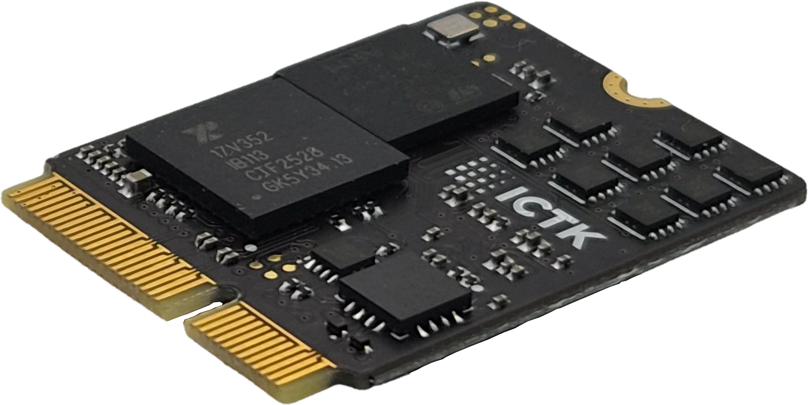
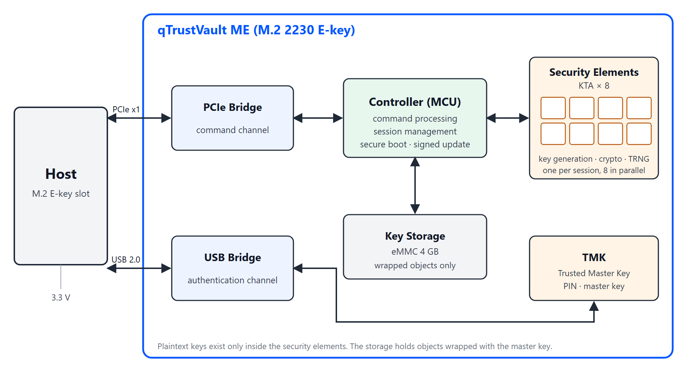
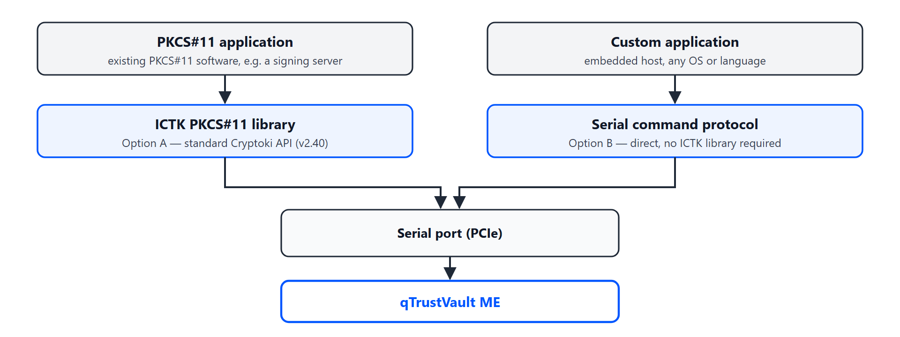

# qTrustVault ME データシート

| | |
| --- | --- |
| 製品 | qTrustVault ME (`IM20001-MRC04-3`) |
| 文書 | データシート (電気的特性を含む) |
| 改訂 | 0.4, 2026-11-03 |
| 状態 | **Draft** |
| 対象ハードウェア | HW 3.1 |
| 発行 | ICTK Co., Ltd. |

---

## 1. 概要 (Overview)

qTrustVault ME は M.2 2230 E-key フォームファクタの HSM (Hardware Security Module) です。鍵の生成、保管、暗号演算、アクセス制御をモジュール単体で実行します。ホストの M.2 E-key スロットに装着すると PCIe 経由でシリアルポートとして認識され、ホストはコマンドプロトコルでデバイスに直接コマンドを送ります。

ユーザー鍵はモジュールに実装された 8 個のセキュアエレメント KTA (Keyless Trust Anchor) の内部で生成・演算され、マスター鍵でラップされた形でのみオンボードストレージに保管されます。平文の鍵が KTA の外に出ることはありません。

### 1.1 特長 (Features)

- **M.2 2230 E-key ハードウェアセキュリティモジュール** — 単一 3.3 V、ホストスロットに挿してそのまま使用
- **セキュアエレメント 8 個の並列動作** — セッションごとに専用セキュアエレメント (KTA)、最大 8 セッション同時処理
- **鍵はデバイスの外に出ない** — 生成と演算はセキュアエレメント内で、保存はマスター鍵でラップした形でのみ
- **幅広いアルゴリズム** — ECDSA・ECDH (P-256、P-384、secp256k1)、EdDSA (Ed25519、Ed448)、X25519・X448、AES-128/256 (CBC、CCM、GCM)、HMAC・SHA-256/384、HKDF、ハードウェア TRNG
- **大容量鍵ストレージ** — 最大 81,920 オブジェクト
- **2 通りの使用方法** — 標準 PKCS#11 (v2.40) ライブラリ、またはライブラリなしでシリアルコマンドプロトコルによる直接制御 (2.1 参照)
- **ファームウェア保護** — 署名検証によるセキュアブート、署名済みイメージのみ受け付けるアップデート、ロールバック防止
- **処理性能** — ECDSA P-256 署名 毎秒約 68 件 (8 セッション並列、8.2 参照環境での実測代表値)
- **動作温度** −25 ~ +85 °C

### 1.2 用途 (Applications)

- サーバー・ゲートウェイの秘密鍵保護 — TLS、デバイス証明書、コード・文書署名
- エッジ・産業機器のデバイス認証とデータ暗号化
- デジタルアセットウォレットとブロックチェーンノードの鍵管理 (secp256k1、Ed25519)
- 鍵管理システム (KMS) のルート鍵・マスター鍵保管
- ファームウェア・ソフトウェア署名サーバー

### 1.3 主な仕様 (Key Specifications)

| 項目 | 内容 |
| --- | --- |
| フォームファクタ | M.2 2230、E-key、単一 3.3 V 電源 |
| ホストインターフェース | PCIe x1 (シリアルポートとして認識)、USB 2.0 Full-Speed |
| セキュアエレメント | KTA 8 個。8 セッション並列処理、セッションごとに専用 KTA をバインド |
| TMK | TMK (Trusted Master Key)。ログイン (PIN) 認証とマスター鍵保管専用のセキュアチップ 1 個 |
| 鍵ストレージ | eMMC 5.1 4 GB、保存オブジェクト最大 81,920 個 |
| 暗号機能 | ECC (P-256、P-384、secp256k1、Ed25519、Ed448、X25519、X448)、AES-128/256 (CBC、CCM、GCM)、HMAC・SHA-256/384、HKDF、ハードウェア TRNG |
| ファームウェア保護 | 署名検証によるセキュアブート、署名済みファームウェアのみ受け付けるセキュアアップデート、ロールバック防止 |
| ホスト連携 | PKCS#11 (v2.40) ライブラリ、またはシリアルコマンドプロトコルによる直接制御 (CBOR ペイロード、CRC-32) |

## 2. 機能構成 (Functional Overview)

| 機能 | ホスト側 | 説明 |
| --- | --- | --- |
| コマンドチャネル | PCIe x1 → シリアルポート | すべてのコマンドと応答が行き来するチャネル |
| 認証チャネル | USB 2.0 | ログイン (PIN) 認証とマスター鍵設定 |
| 暗号演算 | — | セキュアエレメント KTA 8 個。セッションごとに専用 KTA を割り当てて並列処理 |
| 鍵ストレージ | — | 4 GB。マスター鍵でラップされたオブジェクトのみ保存 |

### 2.1 使用方法 (Integration Options)

デバイスはホストのシリアルポートからコマンドを受け取ります。ホストは次の 2 通りのいずれかでデバイスを使用します。

| 方法 | 対象 | 説明 |
| --- | --- | --- |
| PKCS#11 ライブラリ | 既存の PKCS#11 ソフトウェア | ICTK PKCS#11 (v2.40) ライブラリを読み込み、標準 API で使用します。Windows (x64 · x86) 用と Linux (x86_64) 用を提供しています。PKCS#11 リファレンスガイドに従います |
| シリアルコマンドプロトコル | 組込みホスト、自社ソフトウェア | ライブラリなしでコマンドフレーム (CBOR ペイロード、CRC-32) を直接やり取りします。**オペレーティングシステムと言語の制約がありません。** 標準リファレンスマニュアルに従います |

> **参考 — デバイスは PKCS#11 に依存しません**
> PKCS#11 ライブラリはデバイスを使う**方法の一つ**です。デバイス自体のインターフェースはシリアルコマンドプロトコルであり、ライブラリなしでそのプロトコルだけですべての機能を使用できます。

## 3. ピン配置 (Pin Assignment)

### 3.1 コネクタ (Connector)

| 項目 | 値 |
| --- | --- |
| コネクタ | M.2 E-key カードエッジ、75 ピン |
| キー位置 | E (ピン 24 ～ 31 欠番) |

### 3.2 接続ピン (Connected Pins)

方向はモジュール基準です。PCIe 差動ペアの送受信の名称は PCI Express M.2 規格の定義に従います。

| ピン | M.2 信号名 | モジュール機能 | 方向 | レベル | 備考 |
| --- | --- | --- | --- | --- | --- |
| 2, 4, 72, 74 | 3.3V | 主電源 | 電源 | 3.3 V | 4 ピンすべて接続 |
| 1, 7, 18, 33, 39, 45, 51, 57, 63, 69, 75 | GND | グランド | 電源 | — | |
| 3 | USB_D+ | USB 2.0 D+ | 双方向 | USB 2.0 FS |  |
| 5 | USB_D− | USB 2.0 D− | 双方向 | USB 2.0 FS |  |
| 35 | PETp0 | PCIe レーン 0 | 差動 | PCIe | |
| 37 | PETn0 | PCIe レーン 0 | 差動 | PCIe | |
| 41 | PERp0 | PCIe レーン 0 | 差動 | PCIe | |
| 43 | PERn0 | PCIe レーン 0 | 差動 | PCIe | |
| 47 | REFCLKp0 | PCIe 基準クロック 100 MHz | 入力 | HCSL | |
| 49 | REFCLKn0 | PCIe 基準クロック 100 MHz | 入力 | HCSL | |
| 52 | PERST0# | PCIe リセット | 入力 | 3.3 V, active low | |
| 53 | CLKREQ0# | 基準クロック要求 | 出力 | 3.3 V, open-drain, active low | |

### 3.3 未接続ピン (No-Connect Pins)

以下のピンはモジュール内部で接続されていません。ホスト側の状態は動作に影響しません。

| グループ | ピン |
| --- | --- |
| SDIO (9 ～ 23 の奇数) | SDIO_CLK, SDIO_CMD, SDIO_DATA0 ～ 3, SDIO_WAKE#, SDIO_RESET# |
| LED | 6 (LED#1), 16 (LED#2) |
| PCM / I2S | 8, 10, 12, 14 |
| UART | 20 (UART_WAKE#), 22 (UART_RXD), 32 (UART_TXD), 34 (UART_CTS), 36 (UART_RTS) |
| ベンダー定義 | 38, 40, 42 |
| COEX | 44, 46, 48 |
| その他のサイドバンド | 50 (SUSCLK), 54 (W_DISABLE#2), 55 (PEWAKE0#), 56 (W_DISABLE#1), 58 (I2C_SDA), 60 (I2C_SCL), 62 (ALERT#), 64 (RESERVED) |
| PCIe レーン 1 | 59, 61 (PETp1/n1), 65, 67 (PERp1/n1), 71, 73 (REFCLKp1/n1) |
| UIM / レーン 1 サイドバンド | 66, 68, 70 |

> **注記 — PCIe ウェイク**
> PEWAKE0# が接続されていないため、モジュールは PCIe ウェイクイベントを発生させません。

## 4. 電気的特性 (Electrical Characteristics)

### 4.1 絶対最大定格 (Absolute Maximum Ratings)

この値を超える条件では永久的な損傷が発生することがあります。この値での動作は保証しません。

| 項目 | 記号 | 最小 | 最大 | 単位 |
| --- | --- | --- | --- | --- |
| 電源電圧 | V3P3 | −0.3 | 3.6 | V |
| 信号ピン入力電圧 (PERST0#, CLKREQ0#) | VIN | −0.3 | V3P3 + 0.3 | V |
| 保存温度 | TSTG | −40 | +85 | ℃ |

### 4.2 推奨動作条件 (Recommended Operating Conditions)

| 項目 | 記号 | 最小 | 標準 | 最大 | 単位 | 備考 |
| --- | --- | --- | --- | --- | --- | --- |
| 電源電圧 | V3P3 | 3.135 | 3.3 | 3.465 | V | 3.3 V ±5 %、負荷変動を含む |
| 動作温度 (周囲) | TA | −25 | 25 | +85 | ℃ | |
| 信号入力 High (PERST0#) | VIH | 2.0 | — | V3P3 | V | |
| 信号入力 Low (PERST0#) | VIL | 0 | — | 0.8 | V | |

### 4.3 消費電力 (Power Consumption)

| 状態 | 条件 | 標準 | 最大 | 単位 |
| --- | --- | --- | --- | --- |
| 待機 | PCIe リンク接続、コマンドなし | 250 | — | mA |
| 動作 (単一セッション) | ECDSA P-256 署名を連続実行 | 300 | — | mA |
| 動作 (8 セッション並列) | ECDSA P-256 署名を連続実行 | 320 | 450 | mA |
| 消費電力 (待機) | V3P3 = 3.3 V | 0.83 | — | W |
| 消費電力 (動作) | V3P3 = 3.3 V、8 セッション並列 | 1.05 | 1.5 | W |

> **注記 — 測定条件**
> モジュール全体の 3.3 V 入力電流です (PCIe ブリッジ、MCU、セキュアエレメント、eMMC を含む)。標準値は代表値 (Typ.) であり保証値ではありません。最大値は実測最大値にマージンを持たせた設計基準です。電源は最大電流時も推奨動作電圧範囲を維持する必要があります。

### 4.4 電源監視とリセット (Power Supervision & Reset)

| 項目 | 最小 | 標準 | 最大 | 単位 | 備考 |
| --- | --- | --- | --- | --- | --- |
| 低電圧リセット検出電圧 | 2.877 | 2.9 | 2.923 | V | TA = 25 ℃。電源がこの値を下回る間はリセットを保持 |
| リセット解除からコマンド受信可能まで | — | 1,300 | 2,500 | ms | ファームウェア署名検証とセキュアエレメント起動を含む。8.3 参照 |

### 4.5 PCIe インターフェース (PCIe Interface)

| 項目 | 値 |
| --- | --- |
| 規格 | PCI Express 2.0、Gen 1 (2.5 GT/s) |
| レーン | x1 (レーン 0) |
| 基準クロック | ホスト供給 100 MHz (REFCLKp0/n0) |
| デバイス | Exar XR17V352、2 チャネル UART ブリッジ |
| ホストから見えるもの | シリアルポート 2 個 (チャネル 0、チャネル 1) |
| ウェイク | 非対応 (PEWAKE0# 未接続) |
| リンク電源管理 (ASPM) | 使用不可。ホスト側でこのスロットの ASPM を無効にする必要があります (11 参照) |

> **注記 — PCIe リンク電源管理**
> PCIe ブリッジ (XR17V352) は、メーカーのエラッタにより ASPM L1 または L0s & L1
> 状態で誤動作することがあります。その場合、ホストが起動できない、または通信中に
> 停止することがあります。メーカーの回避策は BIOS で ASPM を無効にすることです。
> 出典: MaxLinear XR17V35x Errata 202ER01 (https://www.maxlinear.com/Document/index?id=21149&languageid=1033&type=Errata&partnumber=XR17V352)

### 4.6 USB インターフェース (USB Interface)

| 項目 | 値 |
| --- | --- |
| 規格 | USB 2.0 Full-Speed (12 Mbps) |
| デバイス | Microchip MCP2221A、USB–I2C/UART ブリッジ |
| 用途 | ホストから TMK へのアクセス (ログイン・マスター鍵設定) |
| VBUS | 使用しない (モジュール電源は 3.3V ピンから供給) |

### 4.7 状態表示 (Status Indicator)

| 項目 | 値 |
| --- | --- |
| オンボード LED | 2 個 (Green、Red) |
| Green LED | XR17V352 PCIe ブリッジの電源正常表示。点灯中はブリッジに電源が正常に供給されている状態 |
| Red LED | qTrustVault ME の動作監視。電源投入後の初期化中に点灯し、通常動作に入ると消灯します。デバイスが内部エラー (Fault) で停止すると点灯したままになります |

M.2 の LED#1、LED#2 ピンは使用しません。表示はモジュール上の LED のみで行います。

## 5. ホストシリアルリンク (Host Serial Link)

PCIe ブリッジが提供するシリアルポートを以下の設定で開きます。デバイス側の設定は固定であり、ホスト側も同じ設定に合わせる必要があります。

| パラメータ | 値 | 備考 |
| --- | --- | --- |
| 通信速度 | 6,750,000 bps | |
| フレーム | 8-E-1 | データ 8、偶数パリティ、ストップ 1 |
| フロー制御 | RTS / CTS ハードウェア | **必須**。使用しないと受信オーバーラン |
| 理論最大スループット | 約 613.6 kB/s | 1 バイトあたり 11 ビット。応答 (デバイス → ホスト) 基準 |
| 要求の受信 | フレーム単位 | 1 フレームを受信する間、RTS でホストの送信速度を調整します |
| 最大フレーム | 2,070 B | ペイロード最大 2,048 B |
| 完全性 | CRC-32 (MPEG-2) | |
| 応答順序 | 非順次 | REQUEST_ID で対応付け |

> **注記 — プロトコル仕様**
> パケット形式、セッション、コマンドの仕様は標準リファレンスマニュアルに従います。

## 6. セキュリティ機能 (Security Features)

### 6.1 鍵保護モデル (Key Protection Model)

| 項目 | 内容 |
| --- | --- |
| 鍵生成 | KTA 内部の TRNG |
| 鍵保管 | マスター鍵でラップ (AES-GCM) した後、ストレージに書き込み |
| 平文の鍵 | 演算時にのみ KTA 内部で復元し、演算後に消去 |
| マスター鍵 | デバイス外へ出す経路なし |
| 記憶媒体の複製 | ラップされた暗号文しか得られない。他のデバイスでは復元不可 |
| 鍵のエクスポート | EXTRACTABLE 鍵のみ、ホストが指定した KEK でラップしてエクスポート |

### 6.2 暗号メカニズム (Mechanisms)

| 分類 | 対応 |
| --- | --- |
| 鍵生成 | AES、Generic Secret、EC 鍵ペア、Edwards 鍵ペア、Montgomery 鍵ペア |
| 対称暗号化・復号 | AES-CBC、AES-CCM、AES-GCM |
| 署名・検証 | ECDSA (事前ハッシュ、SHA-256、SHA-384)、EdDSA |
| メッセージ認証 | HMAC-SHA256、HMAC-SHA384 |
| 鍵合意・導出 | ECDH、SHA-256/384 導出、HKDF-SHA256/384 |
| ハッシュ | SHA-256、SHA-384 |
| 乱数 | TRNG、1 回の呼び出しあたり最大 32 B |
| 鍵ラップ | AES-CBC / CCM / GCM |
| 証明書保管 | 外部で発行された証明書をラップして保存 (本体最大 1,184 B) |

### 6.3 曲線と鍵長 (Curves & Key Sizes)

| 規格 | 鍵長 | 用途 |
| --- | --- | --- |
| NIST P-256 | 256 ビット | ECDSA 署名、ECDH |
| NIST P-384 | 384 ビット | ECDSA 署名、ECDH |
| secp256k1 | 256 ビット | ECDSA 署名・検証、ECDH (鍵合意) |
| Ed25519 | 256 ビット | EdDSA 署名 |
| Ed448 | 456 ビット | EdDSA 署名 |
| X25519 | 256 ビット | 鍵合意 |
| X448 | 448 ビット | 鍵合意 |
| AES-128 | 128 ビット | 対称暗号化・復号、鍵ラップ |
| AES-256 | 256 ビット | 対称暗号化・復号、鍵ラップ |

> **参考 — ECDSA 署名形式**
> ECDSA 署名は r と s を連結した生の形式です。256 ビット曲線(P-256、secp256k1)は 64 B、P-384 は 96 B で、DER エンコードではありません。
> secp256k1 署名は low-S に正規化されず、リカバリ識別子 (v) も出力しません。Bitcoin・Ethereum のように low-S と v を要求する体系で使う場合は、ホスト側で s を n−s に変換し、v を自分で求める必要があります。本デバイスの検証は s と n−s の双方を受け付けます。

### 6.4 ファームウェア保護 (Firmware Protection)

| 項目 | 内容 |
| --- | --- |
| セキュアブート | 起動のたびにファームウェア署名 (ECDSA P-256 / SHA-256) を検証 |
| ファームウェア更新 | 署名が検証されたイメージのみインストール。インストール失敗時は以前のファームウェアを維持 |
| ロールバック防止 | セキュリティカウンタが低いイメージはインストールしない |
| デバッグアクセス | 量産品はデバッグポートからの内部メモリ読み出しを遮断 |

## 7. 容量 (Capacity)

| 項目 | 値 |
| --- | --- |
| 最大同時セッション数 | 8 (KTA の数と同じ) |
| セッションオブジェクト (デバイス全体の合計) | 64 |
| 保存オブジェクト最大数 | 81,920 (公開鍵・秘密鍵・共通鍵・証明書 各 20,480) |
| オブジェクトスロットサイズ | 16,384 B |
| オブジェクト専用ストレージ容量 | 1,342,177,280 B (1,280 MB) |
| オブジェクトラベル / ID | 最大 32 B / 4 B |
| 対称暗号化・復号データ | 1 回の呼び出しあたり最大 1,024 B |
| 署名対象メッセージ | 1 回の呼び出しあたり最大 1,024 B |
| ハッシュ入力 | 1 回の呼び出しあたり最大 1,024 B |
| 証明書本体 | 最大 1,184 B |

## 8. 性能 (Performance)

性能は 3 種類に分けて表記します。8.1 はデバイス自体の処理性能、8.2 は ICTK 参照ホスト環境で実測したエンドツーエンドの性能、8.3 は電源投入からコマンドを受け付けるまでの起動時間です。

### 8.1 デバイス処理性能 (Device Performance)

| 演算 | 入力 | 1 件あたりの処理時間 (ms, Typ.) | 1 秒あたりの処理件数 (ops/s, Typ.) |
| --- | --- | --- | --- |
| ECDSA P-256 署名 | 32 B | 29.6 | 34 |
| ECDSA P-256 検証 | 32 B | 29.7 | 34 |
| ECDSA P-384 署名 | 48 B | 48.6 | 21 |
| ECDSA P-384 検証 | 48 B | 50.8 | 20 |
| EdDSA Ed25519 署名 | 32 B | 37.2 | 27 |
| EdDSA Ed25519 検証 | 32 B | 36.7 | 27 |
| EdDSA Ed448 署名 | 32 B | 61.8 | 16 |
| EdDSA Ed448 検証 | 32 B | 63.3 | 16 |
| ECDH P-256 鍵合意 | — | 25.1 | 40 |
| ECDH P-384 鍵合意 | — | 47.6 | 21 |
| X25519 鍵合意 | — | 28.4 | 35 |
| X448 鍵合意 | — | 50.6 | 20 |
| HKDF-SHA256 | 32 B 出力 | 17.5 | 57 |
| HMAC-SHA256 | 16 B | 19.8 | 51 |
| HMAC-SHA256 | 256 B | 20.5 | 49 |
| HMAC-SHA256 | 1,024 B | 22.8 | 44 |
| HMAC-SHA384 | 16 B | 21.7 | 46 |
| HMAC-SHA384 | 256 B | 22.4 | 45 |
| HMAC-SHA384 | 1,024 B | 26.7 | 37 |
| AES-256-GCM 暗号化 | 16 B | 28.4 | 35 |
| AES-256-GCM 暗号化 | 256 B | 29.8 | 34 |
| AES-256-GCM 暗号化 | 1,024 B | 35.2 | 28 |
| AES-256-GCM 復号 | 16 B | 28.7 | 35 |
| AES-256-GCM 復号 | 256 B | 30.2 | 33 |
| AES-256-GCM 復号 | 1,024 B | 34.6 | 29 |
| AES-256-CBC 暗号化 | 16 B | 27.4 | 37 |
| AES-256-CBC 暗号化 | 256 B | 28.4 | 35 |
| AES-256-CBC 暗号化 | 1,024 B | 29.7 | 34 |
| AES-256-CCM 暗号化 | 1,024 B | 30.7 | 33 |
| AES-128-GCM 暗号化 | 1,024 B | 34.8 | 29 |
| SHA-256 | 16 B | 12.4 | 80 |
| SHA-256 | 256 B | 12.3 | 81 |
| SHA-256 | 1,024 B | 14.5 | 69 |
| SHA-384 | 16 B | 12.4 | 81 |
| SHA-384 | 256 B | 13.3 | 75 |
| SHA-384 | 1,024 B | 17.5 | 57 |
| 鍵ペア生成 P-256 (保存を含む) | — | 30.4 | 33 |
| 鍵ペア生成 P-384 (保存を含む) | — | 47.3 | 21 |
| 鍵ペア生成 Ed25519 (保存を含む) | — | 37.7 | 27 |
| 鍵ペア生成 X25519 (保存を含む) | — | 34.2 | 29 |
| AES-128 鍵生成 (保存を含む) | — | 11.9 | 84 |
| AES-256 鍵生成 (保存を含む) | — | 11.7 | 86 |
| 鍵ラップ (AES-256-GCM) | AES-256 鍵 | 13.2 | 76 |
| 鍵アンラップ (AES-256-GCM) | AES-256 鍵 | 18.5 | 54 |
| 乱数生成 | 32 B | 3.3 | 307 |
| ECDSA secp256k1 署名 | 32 B | 37.8 | 26 |
| ECDSA secp256k1 検証 | 32 B | 36.7 | 27 |
| ECDH secp256k1 鍵共有 | — | 36.1 | 28 |
| HKDF-SHA384 | 48 B 出力 | 20.8 | 48 |
| SHA-256 鍵導出 | 32 B 出力 | 15.7 | 64 |
| SHA-384 鍵導出 | 48 B 出力 | 16.6 | 60 |
| AES-256-CBC 復号 | 16 B | 28.6 | 35 |
| AES-256-CBC 復号 | 256 B | 28.6 | 35 |
| AES-256-CBC 復号 | 1,024 B | 29.4 | 34 |
| AES-256-CCM 復号 | 1,024 B | 30.4 | 33 |
| AES-128-GCM 復号 | 1,024 B | 34.5 | 29 |
| 鍵ペア生成 Ed448 (保存を含む) | — | 64.3 | 16 |
| 鍵ペア生成 X448 (保存を含む) | — | 55.8 | 18 |
| 鍵ペア生成 secp256k1 (保存を含む) | — | 38.2 | 26 |

> **注記 — デバイス処理性能の定義**
> 1 件あたりの処理時間は、デバイスが演算 1 件の処理にかかった時間で、デバイスが応答で報告した値です。コマンドを受信してから応答を生成するまでの時間で、ホストとのリンク転送は含みません。
> 1 秒あたりの処理件数は、1 セッションで連続処理したときに 1 秒間に処理できる件数で、1,000 ÷ 1 件あたりの処理時間 (ms) です。例: 1 件 29 ms なら 1 秒あたり 34 件。
> 署名・検証・暗号化・復号・ダイジェストは、INIT コマンドでコンテキストを開いた後の演算 1 件の値です。
> 本表の数値は代表値 (Typ.) であり保証値ではありません。

### 8.2 参照環境での実測 (Reference Host)

| 演算 | 入力 | 1 セッションの処理件数 (ops/s) | 8 セッション同時処理時の合計 (ops/s) |
| --- | --- | --- | --- |
| ECDSA P-256 署名 | 32 B | 33.3 | 68.6 |
| ECDSA P-256 検証 | 32 B | 33.3 | 68.2 |
| ECDSA P-384 署名 | 48 B | 20.4 | 67.9 |
| ECDSA P-384 検証 | 48 B | 19.5 | 67.1 |
| EdDSA Ed25519 署名 | 32 B | 26.6 | 68.4 |
| EdDSA Ed25519 検証 | 32 B | 27.0 | 67.9 |
| EdDSA Ed448 署名 | 32 B | 16.0 | 67.5 |
| EdDSA Ed448 検証 | 32 B | 15.7 | 67.1 |
| ECDH P-256 鍵合意 | — | 38.7 | 111.6 |
| ECDH P-384 鍵合意 | — | 20.7 | 109.9 |
| X25519 鍵合意 | — | 34.5 | 111.6 |
| X448 鍵合意 | — | 19.5 | 110.3 |
| HKDF-SHA256 | 32 B 出力 | 54.8 | 112.3 |
| HMAC-SHA256 | 16 B | 50.0 | 68.8 |
| HMAC-SHA256 | 256 B | 46.9 | 68.8 |
| HMAC-SHA256 | 1,024 B | 39.8 | 68.9 |
| HMAC-SHA384 | 16 B | 45.5 | 68.5 |
| HMAC-SHA384 | 256 B | 42.8 | 68.7 |
| HMAC-SHA384 | 1,024 B | 34.3 | 68.2 |
| AES-256-GCM 暗号化 | 16 B | 34.0 | 43.2 |
| AES-256-GCM 暗号化 | 256 B | 31.4 | 43.2 |
| AES-256-GCM 暗号化 | 1,024 B | 24.7 | 42.9 |
| AES-256-GCM 復号 | 16 B | 34.3 | 43.8 |
| AES-256-GCM 復号 | 256 B | 31.5 | 43.8 |
| AES-256-GCM 復号 | 1,024 B | 25.2 | 43.5 |
| AES-256-CBC 暗号化 | 16 B | 35.2 | 43.2 |
| AES-256-CBC 暗号化 | 256 B | 32.8 | 43.2 |
| AES-256-CBC 暗号化 | 1,024 B | 28.4 | 43.0 |
| AES-256-CCM 暗号化 | 1,024 B | 27.6 | 43.0 |
| AES-128-GCM 暗号化 | 1,024 B | 24.8 | 43.0 |
| SHA-256 | 16 B | 76.2 | 93.8 |
| SHA-256 | 256 B | 73.6 | 94.1 |
| SHA-256 | 1,024 B | 58.0 | 93.6 |
| SHA-384 | 16 B | 76.2 | 93.7 |
| SHA-384 | 256 B | 68.3 | 94.1 |
| SHA-384 | 1,024 B | 49.2 | 93.8 |
| 鍵ペア生成 P-256 (保存を含む) | — | 32.6 | 83.8 |
| 鍵ペア生成 P-384 (保存を含む) | — | 21.0 | 77.7 |
| 鍵ペア生成 Ed25519 (保存を含む) | — | 26.4 | 81.3 |
| 鍵ペア生成 X25519 (保存を含む) | — | 29.1 | 82.8 |
| AES-128 鍵生成 (保存を含む) | — | 82.7 | 164.8 |
| AES-256 鍵生成 (保存を含む) | — | 84.9 | 164.8 |
| 鍵ラップ (AES-256-GCM) | AES-256 鍵 | 69.8 | 130.4 |
| 鍵アンラップ (AES-256-GCM、保存を含む) | AES-256 鍵 | 53.3 | 114.0 |
| 乱数生成 | 32 B | 271.8 | 672.2 |
| ECDSA secp256k1 署名 | 32 B | 26.1 | 68.6 |
| ECDSA secp256k1 検証 | 32 B | 27.0 | 68.3 |
| ECDH secp256k1 鍵共有 | — | 27.2 | 111.3 |
| HKDF-SHA384 | 48 B 出力 | 46.6 | 112.4 |
| SHA-256 鍵導出 | 32 B 出力 | 61.4 | 112.5 |
| SHA-384 鍵導出 | 48 B 出力 | 58.0 | 113.2 |
| AES-256-CBC 復号 | 16 B | 34.5 | 43.9 |
| AES-256-CBC 復号 | 256 B | 33.1 | 43.8 |
| AES-256-CBC 復号 | 1,024 B | 29.0 | 43.4 |
| AES-256-CCM 復号 | 1,024 B | 28.1 | 43.4 |
| AES-128-GCM 復号 | 1,024 B | 25.2 | 43.3 |
| 鍵ペア生成 Ed448 (保存を含む) | — | 15.5 | 74.5 |
| 鍵ペア生成 X448 (保存を含む) | — | 17.9 | 74.5 |
| 鍵ペア生成 secp256k1 (保存を含む) | — | 26.1 | 80.6 |

セッション数ごとの合計スループット (ECDSA P-256 署名、INIT を含む):

| 同時セッション数 | 1 | 2 | 4 | 8 |
| --- | --- | --- | --- | --- |
| 合計 (ops/s) | 32 | 50 | 67 | 68 |

> **注記 — 参照環境**
> Windows 11、Intel Core i7-12700、ICTK ホストライブラリと XR17V352 ドライバで測定したエンドツーエンドの値です。ホストが要求を送信してから応答を受信するまでを 1 件と数えます。
> 1 セッションの値は演算 1 件あたりの値で、8 セッションの値は 8 個のセッションが同時に要求し、デバイスが使用可能な KTA を自動的に割り当てる運用条件での合計です。署名・検証・暗号化・復号・HMAC・ダイジェストの 8 セッションの値は INIT を含む処理サイクル基準です。
> デバイスはコマンドを 1 フレームずつ受信し、受信中は RTS フロー制御でホストの送信速度を調整します。
> 本表の数値は代表値 (Typ.) であり保証値ではありません。

### 8.3 起動時間 (Startup Time)

| 項目 | Typ. | Max. |
| --- | --- | --- |
| 起動時間 (リセット解除 → コマンド応答可能) | 1.3 s | 2.5 s |

> **参考 — 起動時間**
> リセットが解除されてから、デバイスがホストのコマンドに応答できるようになるまでの時間です。セキュアブートのファームウェア署名検証と、内蔵セキュアエレメント 8 個の起動を含みます。
> 起動時間は起動ごとに異なる場合があります。Typ. は代表値であり保証値ではありません。
> **ホストはリセット解除後のコマンド応答待ち時間を Max. 以上に設定してください。**

## 9. 機械的特性 (Mechanical)

| 項目 | 値 |
| --- | --- |
| フォームファクタ | M.2 Type 2230 (22 × 30 mm) |
| キー | E |
| 厚さ | 3.3 mm |
| 固定 | M.2 標準固定ネジ 1 本 |
| 重量 | 2.7 g |

## 10. 環境および規格 (Environmental & Compliance)

| 項目 | 値 |
| --- | --- |
| 動作温度 | −25 ～ +85 ℃ (周囲) |
| 保存温度 | −40 ～ +85 ℃ |
| 動作湿度 | 20 ～ 90 % RH (結露なきこと) |
| EMC 認証 | KC 適合登録 (KS C 9832、KS C 9835) |
| | CE — EN 55032、EN 55035 |
| | VCCI — CISPR 32 |

## 11. ホスト要件 (Host Requirements)

| 項目 | 要件 |
| --- | --- |
| スロット | M.2 E-key、PCIe x1 と USB 2.0 の両方が配線されたスロット |
| オペレーティングシステム | シリアルコマンドプロトコルで使う場合は制約なし (Windows、Linux など)。**PKCS#11 ライブラリは Windows (x64 · x86) · Linux (x86_64)** |
| ドライバ | PCIe–UART ブリッジドライバ (ベンダー配布パッケージ) |
| PCIe 電源管理 | このスロットの ASPM を無効にできること (BIOS 設定)。4.5 参照 |
| ソフトウェア | PKCS#11 ライブラリ、またはシリアルコマンドプロトコルを実装したホストプログラム (2.1 参照) |

## 12. 注文情報 (Ordering Information)

| モデル | ストレージ | 備考 |
| --- | --- | --- |
| IM20001-MRC04-3 | eMMC 4 GB | |

## 13. 関連文書 (Related Documents)

| 文書 | 内容 |
| --- | --- |
| qTrustVault ME 標準リファレンスマニュアル および 技術仕様書 | シリアルフレーム、セッション、コマンド、オブジェクト、メカニズム |
| qTrustVault ME PKCS#11 Reference Guide | PKCS#11 ライブラリでデバイスを使う方法、対応メカニズムとオブジェクト属性 |
| MaxLinear XR17V35x Errata (202ER01) | PCIe ブリッジのエラッタ。ASPM 制約の根拠 (4.5) |
