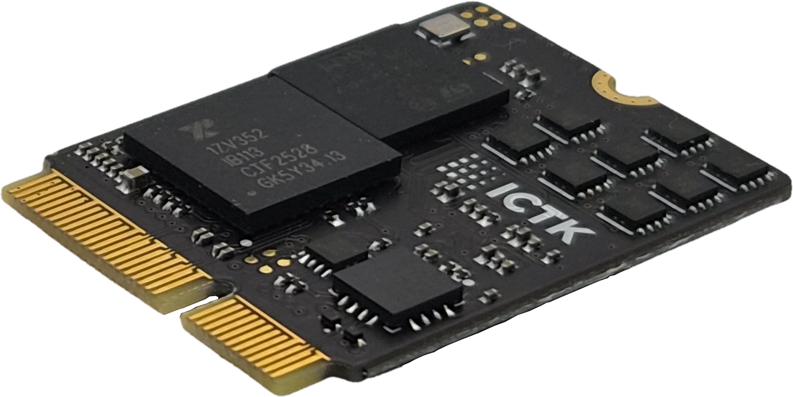
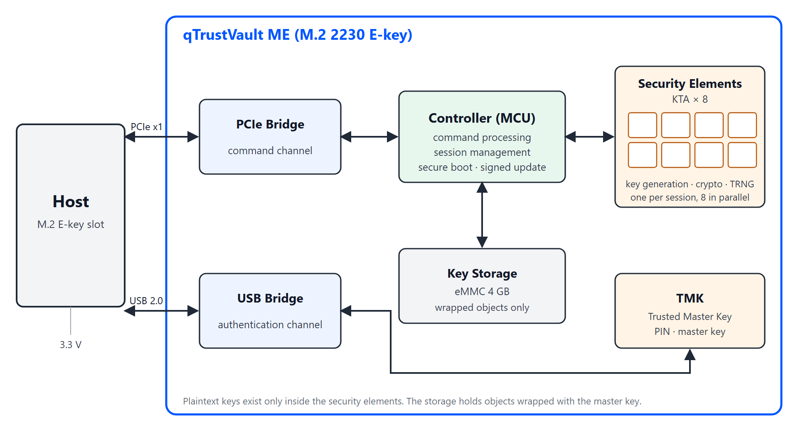
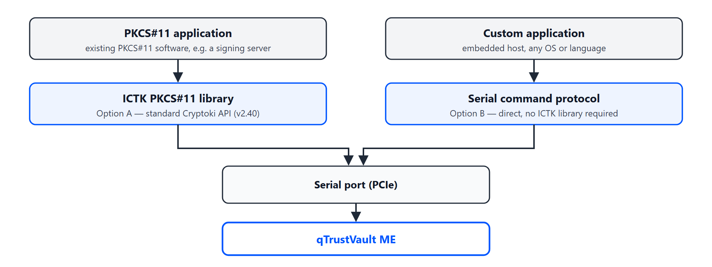

# qTrustVault ME 데이터 시트

| | |
| --- | --- |
| 제품 | qTrustVault ME (`IM20001-MRC04-3`) |
| 문서 | 데이터 시트 (전기적 특성 포함) |
| 개정 | 0.4, 2026-11-11 |
| 상태 | **Draft** |
| 적용 하드웨어 | HW 3.1 |
| 발행 | ICTK Co., Ltd. |

---

## 1. 개요 (Overview)

qTrustVault ME 는 M.2 2230 E-key 폼팩터의 HSM(Hardware Security Module)입니다.
키 생성, 보관, 암호 연산, 접근 제어를 모듈이 단독으로 수행합니다. 호스트의 M.2
E-key 슬롯에 장착하면 PCIe 를 통해 직렬 포트로 인식되고, 호스트는 명령
프로토콜로 장치에 직접 명령을 보냅니다.

사용자 키는 모듈에 실장된 8개의 보안 소자 KTA(Keyless Trust Anchor) 안에서
생성·연산되고, 마스터 키로 래핑된 형태로만 온보드 저장소에 보관됩니다. 평문 키는
KTA 밖으로 나가지 않습니다.

### 1.1 특징 (Features)

- **M.2 2230 E-key 하드웨어 보안 모듈** — 단일 3.3 V, 호스트 슬롯에 꽂아 바로 사용
- **보안 소자 8 개 병렬** — 세션마다 전용 보안 소자(KTA), 최대 8 세션 동시 처리
- **키는 장치 밖으로 나가지 않음** — 생성과 연산은 보안 소자 안에서, 저장은 마스터 키로 래핑한 형태로만
- **폭넓은 알고리즘** — ECDSA · ECDH (P-256, P-384, secp256k1), EdDSA (Ed25519, Ed448), X25519 · X448, AES-128/256 (CBC, CCM, GCM), HMAC · SHA-256/384, HKDF, 하드웨어 TRNG
- **대용량 키 저장** — 최대 81,920 객체
- **두 가지 사용 방법** — 표준 PKCS#11 (v2.40) 라이브러리, 또는 라이브러리 없이 직렬 명령 프로토콜로 직접 제어 (2.1 참조)
- **펌웨어 보호** — 서명 검증 보안 부트, 서명된 이미지만 받는 업데이트, 롤백 방지
- **처리 성능** — ECDSA P-256 서명 초당 약 68 건 (8 세션 병렬, 8.2 참조 환경의 실측 대표값)
- **동작 온도** −25 ~ +85 °C

### 1.2 용도 (Applications)

- 서버 · 게이트웨이의 개인 키 보호 — TLS, 장치 인증서, 코드 · 문서 서명
- 엣지 · 산업용 장비의 장치 인증과 데이터 암호화
- 디지털 자산 지갑과 블록체인 노드의 키 관리 (secp256k1, Ed25519)
- 키 관리 시스템(KMS)의 루트 키 · 마스터 키 보관
- 펌웨어 · 소프트웨어 서명 서버

### 1.3 주요 사양 (Key Specifications)

| 항목 | 내용 |
| --- | --- |
| 폼팩터 | M.2 2230, E-key, 단일 3.3 V 전원 |
| 호스트 인터페이스 | PCIe x1 (직렬 포트로 인식), USB 2.0 Full-Speed |
| 보안 소자 | KTA 8개. 8개 세션 병렬 처리, 세션마다 전용 KTA 바인딩 |
| TMK | TMK(Trusted Master Key). 로그인(PIN) 인증과 마스터 키 보관 전용 보안 칩 1개 |
| 키 저장소 | eMMC 5.1 4 GB, 저장 객체 최대 81,920개 |
| 암호 기능 | ECC (P-256, P-384, secp256k1, Ed25519, Ed448, X25519, X448), AES-128/256 (CBC, CCM, GCM), HMAC·SHA-256/384, HKDF, 하드웨어 TRNG |
| 펌웨어 보호 | 서명 검증 보안 부트, 서명된 펌웨어만 받아들이는 보안 업데이트, 롤백 방지 |
| 호스트 연동 | PKCS#11 (v2.40) 라이브러리, 또는 직렬 명령 프로토콜 직접 제어 (CBOR 페이로드, CRC-32) |

## 2. 기능 구성 (Functional Overview)

| 기능 | 호스트 쪽 | 설명 |
| --- | --- | --- |
| 명령 채널 | PCIe x1 → 직렬 포트 | 모든 명령과 응답이 오가는 채널 |
| 인증 채널 | USB 2.0 | 로그인(PIN) 인증과 마스터 키 설정 |
| 암호 연산 | — | 보안 소자 KTA 8개. 세션마다 전용 KTA 를 배정해 병렬 처리 |
| 키 저장소 | — | 4 GB. 마스터 키로 래핑된 객체만 저장 |

### 2.1 사용 방법 (Integration Options)

장치는 호스트의 직렬 포트로 명령을 받습니다. 호스트는 둘 중 하나로 장치를 사용합니다.

| 방법 | 대상 | 설명 |
| --- | --- | --- |
| PKCS#11 라이브러리 | 기존 PKCS#11 소프트웨어 | ICTK PKCS#11 (v2.40) 라이브러리를 불러 표준 API 로 사용합니다. Windows (x64 · x86) 용과 Linux (x86_64) 용을 제공합니다. PKCS#11 참조 가이드를 따릅니다 |
| 직렬 명령 프로토콜 | 임베디드 호스트, 자체 소프트웨어 | 라이브러리 없이 명령 프레임(CBOR 페이로드, CRC-32)을 직접 주고받습니다. **운영체제와 언어에 제약이 없습니다.** 표준 참조 매뉴얼을 따릅니다 |

> **참고 — 장치는 PKCS#11 에 종속되지 않습니다**
> PKCS#11 라이브러리는 장치를 쓰는 **방법 중 하나**입니다. 장치 자체의 인터페이스는 직렬 명령 프로토콜이며, 라이브러리 없이 그 프로토콜만으로 모든 기능을 쓸 수 있습니다.

## 3. 핀 배치 (Pin Assignment)

### 3.1 커넥터 (Connector)

| 항목 | 값 |
| --- | --- |
| 커넥터 | M.2 E-key 카드 엣지, 75 핀 |
| 키 위치 | E (핀 24 ~ 31 결번) |

### 3.2 연결된 핀 (Connected Pins)

방향은 모듈 기준입니다. PCIe 차동쌍의 송·수신 명칭은 PCI Express M.2 규격의 정의를 따릅니다.

| 핀 | M.2 신호명 | 모듈 기능 | 방향 | 레벨 | 비고 |
| --- | --- | --- | --- | --- | --- |
| 2, 4, 72, 74 | 3.3V | 주 전원 | 전원 | 3.3 V | 4핀 모두 연결 |
| 1, 7, 18, 33, 39, 45, 51, 57, 63, 69, 75 | GND | 접지 | 전원 | — | |
| 3 | USB_D+ | USB 2.0 D+ | 양방향 | USB 2.0 FS |  |
| 5 | USB_D− | USB 2.0 D− | 양방향 | USB 2.0 FS |  |
| 35 | PETp0 | PCIe 레인 0 | 차동 | PCIe | |
| 37 | PETn0 | PCIe 레인 0 | 차동 | PCIe | |
| 41 | PERp0 | PCIe 레인 0 | 차동 | PCIe | |
| 43 | PERn0 | PCIe 레인 0 | 차동 | PCIe | |
| 47 | REFCLKp0 | PCIe 기준 클럭 100 MHz | 입력 | HCSL | |
| 49 | REFCLKn0 | PCIe 기준 클럭 100 MHz | 입력 | HCSL | |
| 52 | PERST0# | PCIe 리셋 | 입력 | 3.3 V, active low | |
| 53 | CLKREQ0# | 기준 클럭 요청 | 출력 | 3.3 V, open-drain, active low | |

### 3.3 연결하지 않은 핀 (No-Connect Pins)

아래 핀은 모듈 내부에 연결되어 있지 않습니다. 호스트 쪽 상태는 동작에 영향을 주지 않습니다.

| 그룹 | 핀 |
| --- | --- |
| SDIO (9 ~ 23 홀수) | SDIO_CLK, SDIO_CMD, SDIO_DATA0 ~ 3, SDIO_WAKE#, SDIO_RESET# |
| LED | 6 (LED#1), 16 (LED#2) |
| PCM / I2S | 8, 10, 12, 14 |
| UART | 20 (UART_WAKE#), 22 (UART_RXD), 32 (UART_TXD), 34 (UART_CTS), 36 (UART_RTS) |
| 벤더 정의 | 38, 40, 42 |
| COEX | 44, 46, 48 |
| 기타 사이드밴드 | 50 (SUSCLK), 54 (W_DISABLE#2), 55 (PEWAKE0#), 56 (W_DISABLE#1), 58 (I2C_SDA), 60 (I2C_SCL), 62 (ALERT#), 64 (RESERVED) |
| PCIe 레인 1 | 59, 61 (PETp1/n1), 65, 67 (PERp1/n1), 71, 73 (REFCLKp1/n1) |
| UIM / 레인 1 사이드밴드 | 66, 68, 70 |

> **참고 — PCIe 웨이크**
> PEWAKE0# 가 연결되어 있지 않으므로 모듈은 PCIe 웨이크 이벤트를 발생시키지 않습니다.

## 4. 전기적 특성 (Electrical Characteristics)

### 4.1 절대 최대 정격 (Absolute Maximum Ratings)

이 값을 넘는 조건에서는 영구 손상이 발생할 수 있습니다. 이 값에서의 동작은 보증하지 않습니다.

| 항목 | 기호 | 최소 | 최대 | 단위 |
| --- | --- | --- | --- | --- |
| 전원 전압 | V3P3 | −0.3 | 3.6 | V |
| 신호 핀 입력 전압 (PERST0#, CLKREQ0#) | VIN | −0.3 | V3P3 + 0.3 | V |
| 보관 온도 | TSTG | −40 | +85 | °C |

### 4.2 권장 동작 조건 (Recommended Operating Conditions)

| 항목 | 기호 | 최소 | 표준 | 최대 | 단위 | 비고 |
| --- | --- | --- | --- | --- | --- | --- |
| 전원 전압 | V3P3 | 3.135 | 3.3 | 3.465 | V | 3.3 V ±5 %, 부하 변동 포함 |
| 동작 온도 (주위) | TA | −25 | 25 | +85 | °C | |
| 신호 입력 High (PERST0#) | VIH | 2.0 | — | V3P3 | V | |
| 신호 입력 Low (PERST0#) | VIL | 0 | — | 0.8 | V | |

### 4.3 소비 전력 (Power Consumption)

| 상태 | 조건 | 표준 | 최대 | 단위 |
| --- | --- | --- | --- | --- |
| 대기 | PCIe 링크 연결, 명령 없음 | 250 | — | mA |
| 동작 (단일 세션) | ECDSA P-256 서명 연속 | 300 | — | mA |
| 동작 (8 세션 병렬) | ECDSA P-256 서명 연속 | 320 | 450 | mA |
| 소비 전력 (대기) | V3P3 = 3.3 V | 0.83 | — | W |
| 소비 전력 (동작) | V3P3 = 3.3 V, 8 세션 병렬 | 1.05 | 1.5 | W |

> **참고 — 측정 조건**
> 모듈 전체의 3.3 V 입력 전류입니다(PCIe 브리지, MCU, 보안 소자, eMMC 포함). 표준값은 대표값(Typ.)이며 보증값이 아닙니다. 최대값은 실측 최대에 여유를 둔 설계 기준입니다. 전원은 최대 전류에서도 권장 동작 전압 범위를 유지해야 합니다.

### 4.4 전원 감시와 리셋 (Power Supervision & Reset)

| 항목 | 최소 | 표준 | 최대 | 단위 | 비고 |
| --- | --- | --- | --- | --- | --- |
| 저전압 리셋 검출 전압 | 2.877 | 2.9 | 2.923 | V | TA = 25 °C. 전원이 이 값 아래면 리셋 유지 |
| 리셋 해제 후 명령 수신 가능까지 | — | 1,300 | 2,500 | ms | 펌웨어 서명 검증과 보안 소자 기동 포함. 8.3 참조 |

### 4.5 PCIe 인터페이스 (PCIe Interface)

| 항목 | 값 |
| --- | --- |
| 규격 | PCI Express 2.0, Gen 1 (2.5 GT/s) |
| 레인 | x1 (레인 0) |
| 기준 클럭 | 호스트 공급 100 MHz (REFCLKp0/n0) |
| 디바이스 | Exar XR17V352, 2채널 UART 브리지 |
| 호스트에 보이는 것 | 직렬 포트 2개 (채널 0, 채널 1) |
| 웨이크 | 미지원 (PEWAKE0# 미연결) |
| 링크 전원 관리 (ASPM) | 사용 불가. 호스트에서 이 슬롯의 ASPM 을 꺼야 합니다 (11 참조) |

> **참고 — PCIe 링크 전원 관리**
> PCIe 브리지(XR17V352)는 제조사 정오표에 따라 ASPM L1 또는 L0s & L1 상태에서
> 오동작할 수 있습니다. 이 경우 호스트가 부팅하지 못하거나 통신 중 멈출 수 있습니다.
> 제조사 우회책은 BIOS 에서 ASPM 을 끄는 것입니다.
> 출처: MaxLinear XR17V35x Errata 202ER01 (https://www.maxlinear.com/Document/index?id=21149&languageid=1033&type=Errata&partnumber=XR17V352)

### 4.6 USB 인터페이스 (USB Interface)

| 항목 | 값 |
| --- | --- |
| 규격 | USB 2.0 Full-Speed (12 Mbps) |
| 디바이스 | Microchip MCP2221A, USB–I2C/UART 브리지 |
| 용도 | 호스트에서 TMK 에 접근 (로그인·마스터 키 설정) |
| VBUS | 사용하지 않음 (모듈 전원은 3.3V 핀에서 공급) |

### 4.7 상태 표시 (Status Indicator)

| 항목 | 값 |
| --- | --- |
| 온보드 LED | 2개 (Green, Red) |
| Green LED | XR17V352 PCIe 브리지 전원 정상 표시. 켜져 있으면 브리지에 전원이 정상 공급되는 상태 |
| Red LED | qTrustVault ME 동작 감시. 전원 투입 후 초기화 중에 켜졌다가 정상 동작에 들어가면 꺼집니다. 장치가 내부 오류(Fault)로 정지하면 켜진 채로 유지됩니다 |

## 5. 호스트 직렬 링크 (Host Serial Link)

PCIe 브리지가 제공하는 직렬 포트를 아래 설정으로 엽니다. 장치 쪽 설정은 고정이며
호스트 쪽도 같게 맞춰야 합니다.

| 파라미터 | 값 | 비고 |
| --- | --- | --- |
| 통신 속도 | 6,750,000 bps | |
| 프레임 | 8-E-1 | 데이터 8, 짝수 패리티, 정지 1 |
| 흐름 제어 | RTS / CTS 하드웨어 | **필수**. 사용하지 않으면 수신 오버런 |
| 이론 최대 처리량 | 약 613.6 kB/s | 바이트당 11 비트. 응답(장치 → 호스트) 기준 |
| 요청 수신 | 프레임 단위 | 한 프레임을 받는 동안 RTS 로 호스트 송신 속도를 조절합니다 |
| 최대 프레임 | 2,070 B | 페이로드 최대 2,048 B |
| 무결성 | CRC-32 (MPEG-2) | |
| 응답 순서 | 비순차 | REQUEST_ID 로 매칭 |

> **참고 — 프로토콜 규격**
> 패킷 형식, 세션, 명령 규격은 표준 참조 매뉴얼을 따릅니다.

## 6. 보안 기능 (Security Features)

### 6.1 키 보호 모델 (Key Protection Model)

| 항목 | 내용 |
| --- | --- |
| 키 생성 | KTA 내부 TRNG |
| 키 보관 | 마스터 키로 래핑(AES-GCM)한 뒤 저장소에 기록 |
| 평문 키 | 연산 시점에만 KTA 내부에 복원, 연산 후 소거 |
| 마스터 키 | 장치 밖으로 내보내는 경로 없음 |
| 저장 매체 복제 | 래핑된 암호문만 얻음. 다른 장치에서 복원 불가 |
| 키 반출 | EXTRACTABLE 키만, 호스트가 지정한 KEK 로 래핑해서 반출 |

### 6.2 암호 메커니즘 (Mechanisms)

| 분류 | 지원 |
| --- | --- |
| 키 생성 | AES, Generic Secret, EC 키 쌍, Edwards 키 쌍, Montgomery 키 쌍 |
| 대칭 암·복호 | AES-CBC, AES-CCM, AES-GCM |
| 서명·검증 | ECDSA (사전 해시, SHA-256, SHA-384), EdDSA |
| 메시지 인증 | HMAC-SHA256, HMAC-SHA384 |
| 키 합의·유도 | ECDH, SHA-256/384 유도, HKDF-SHA256/384 |
| 해시 | SHA-256, SHA-384 |
| 난수 | TRNG, 호출당 최대 32 B |
| 키 래핑 | AES-CBC / CCM / GCM |
| 인증서 보관 | 외부에서 발급된 인증서를 래핑해 저장 (본문 최대 1,184 B) |

### 6.3 곡선과 키 크기 (Curves & Key Sizes)

| 규격 | 키 크기 | 용도 |
| --- | --- | --- |
| NIST P-256 | 256 비트 | ECDSA 서명, ECDH |
| NIST P-384 | 384 비트 | ECDSA 서명, ECDH |
| secp256k1 | 256 비트 | ECDSA 서명·검증, ECDH (키 합의) |
| Ed25519 | 256 비트 | EdDSA 서명 |
| Ed448 | 456 비트 | EdDSA 서명 |
| X25519 | 256 비트 | 키 합의 |
| X448 | 448 비트 | 키 합의 |
| AES-128 | 128 비트 | 대칭 암·복호, 키 래핑 |
| AES-256 | 256 비트 | 대칭 암·복호, 키 래핑 |

> **참고 — ECDSA 서명 형식**
> ECDSA 서명은 r 과 s 를 이어 붙인 원시 형식입니다. 256 비트 곡선(P-256, secp256k1)은 64 B, P-384 는 96 B 이며 DER 인코딩이 아닙니다.
> secp256k1 서명은 low-S 로 정규화하지 않고 복구 식별자(v)도 함께 내보내지 않습니다. Bitcoin·Ethereum 처럼 low-S 와 v 를 요구하는 체계에 쓰려면 호스트에서 s 를 n−s 로 바꾸고 v 를 직접 구해야 합니다. 이 장치의 검증은 s 와 n−s 를 모두 받아들입니다.

### 6.4 펌웨어 보호 (Firmware Protection)

| 항목 | 내용 |
| --- | --- |
| 보안 부트 | 부팅할 때마다 펌웨어 서명(ECDSA P-256 / SHA-256) 검증 |
| 펌웨어 업데이트 | 서명이 검증된 이미지만 설치. 설치 실패 시 이전 펌웨어 유지 |
| 롤백 방지 | 보안 카운터가 낮은 이미지는 설치하지 않음 |
| 디버그 접근 | 양산품은 디버그 포트를 통한 내부 메모리 판독 차단 |

## 7. 용량 (Capacity)

| 항목 | 값 |
| --- | --- |
| 최대 동시 세션 | 8 (KTA 수와 같음) |
| 세션 객체 (장치 전체 합계) | 64 |
| 저장 객체 최대 개수 | 81,920 (공개키·개인키·대칭키·인증서 각 20,480) |
| 객체 슬롯 크기 | 16,384 B |
| 객체 전용 저장 용량 | 1,342,177,280 B (1,280 MB) |
| 객체 라벨 / ID | 최대 32 B / 4 B |
| 대칭 암·복호 데이터 | 호출당 최대 1,024 B |
| 서명 대상 메시지 | 호출당 최대 1,024 B |
| 해시 입력 | 호출당 최대 1,024 B |
| 인증서 본문 | 최대 1,184 B |

## 8. 성능 (Performance)

성능은 세 가지로 나누어 표기합니다. 8.1 은 장치 자체의 처리 성능, 8.2 는 ICTK 참조 호스트 환경에서 실측한 종단 간 성능, 8.3 은 전원 투입에서 명령을 받기까지의 기동 시간입니다.

### 8.1 장치 처리 성능 (Device Performance)

| 연산 | 입력 | 1건 처리 시간 (ms, Typ.) | 초당 처리 건수 (ops/s, Typ.) |
| --- | --- | --- | --- |
| ECDSA P-256 서명 | 32 B | 29.6 | 34 |
| ECDSA P-256 검증 | 32 B | 29.7 | 34 |
| ECDSA P-384 서명 | 48 B | 48.6 | 21 |
| ECDSA P-384 검증 | 48 B | 50.8 | 20 |
| EdDSA Ed25519 서명 | 32 B | 37.2 | 27 |
| EdDSA Ed25519 검증 | 32 B | 36.7 | 27 |
| EdDSA Ed448 서명 | 32 B | 61.8 | 16 |
| EdDSA Ed448 검증 | 32 B | 63.3 | 16 |
| ECDH P-256 키 합의 | — | 25.1 | 40 |
| ECDH P-384 키 합의 | — | 47.6 | 21 |
| X25519 키 합의 | — | 28.4 | 35 |
| X448 키 합의 | — | 50.6 | 20 |
| HKDF-SHA256 | 32 B 출력 | 17.5 | 57 |
| HMAC-SHA256 | 16 B | 19.8 | 51 |
| HMAC-SHA256 | 256 B | 20.5 | 49 |
| HMAC-SHA256 | 1,024 B | 22.8 | 44 |
| HMAC-SHA384 | 16 B | 21.7 | 46 |
| HMAC-SHA384 | 256 B | 22.4 | 45 |
| HMAC-SHA384 | 1,024 B | 26.7 | 37 |
| AES-256-GCM 암호화 | 16 B | 28.4 | 35 |
| AES-256-GCM 암호화 | 256 B | 29.8 | 34 |
| AES-256-GCM 암호화 | 1,024 B | 35.2 | 28 |
| AES-256-GCM 복호 | 16 B | 28.7 | 35 |
| AES-256-GCM 복호 | 256 B | 30.2 | 33 |
| AES-256-GCM 복호 | 1,024 B | 34.6 | 29 |
| AES-256-CBC 암호화 | 16 B | 27.4 | 37 |
| AES-256-CBC 암호화 | 256 B | 28.4 | 35 |
| AES-256-CBC 암호화 | 1,024 B | 29.7 | 34 |
| AES-256-CCM 암호화 | 1,024 B | 30.7 | 33 |
| AES-128-GCM 암호화 | 1,024 B | 34.8 | 29 |
| SHA-256 | 16 B | 12.4 | 80 |
| SHA-256 | 256 B | 12.3 | 81 |
| SHA-256 | 1,024 B | 14.5 | 69 |
| SHA-384 | 16 B | 12.4 | 81 |
| SHA-384 | 256 B | 13.3 | 75 |
| SHA-384 | 1,024 B | 17.5 | 57 |
| 키 쌍 생성 P-256 (저장 포함) | — | 30.4 | 33 |
| 키 쌍 생성 P-384 (저장 포함) | — | 47.3 | 21 |
| 키 쌍 생성 Ed25519 (저장 포함) | — | 37.7 | 27 |
| 키 쌍 생성 X25519 (저장 포함) | — | 34.2 | 29 |
| AES-128 키 생성 (저장 포함) | — | 11.9 | 84 |
| AES-256 키 생성 (저장 포함) | — | 11.7 | 86 |
| 키 래핑 (AES-256-GCM) | AES-256 키 | 13.2 | 76 |
| 키 언래핑 (AES-256-GCM) | AES-256 키 | 18.5 | 54 |
| 난수 생성 | 32 B | 3.3 | 307 |
| ECDSA secp256k1 서명 | 32 B | 37.8 | 26 |
| ECDSA secp256k1 검증 | 32 B | 36.7 | 27 |
| ECDH secp256k1 키 합의 | — | 36.1 | 28 |
| HKDF-SHA384 | 48 B 출력 | 20.8 | 48 |
| SHA-256 키 유도 | 32 B 출력 | 15.7 | 64 |
| SHA-384 키 유도 | 48 B 출력 | 16.6 | 60 |
| AES-256-CBC 복호 | 16 B | 28.6 | 35 |
| AES-256-CBC 복호 | 256 B | 28.6 | 35 |
| AES-256-CBC 복호 | 1,024 B | 29.4 | 34 |
| AES-256-CCM 복호 | 1,024 B | 30.4 | 33 |
| AES-128-GCM 복호 | 1,024 B | 34.5 | 29 |
| 키 쌍 생성 Ed448 (저장 포함) | — | 64.3 | 16 |
| 키 쌍 생성 X448 (저장 포함) | — | 55.8 | 18 |
| 키 쌍 생성 secp256k1 (저장 포함) | — | 38.2 | 26 |

> **참고 — 장치 처리 성능의 정의**
> 1건 처리 시간은 장치가 연산 1건을 처리하는 데 걸린 시간으로, 장치가 응답에 보고한 값입니다. 명령을 받은 뒤 응답을 만들기까지이며, 호스트와의 링크 전송은 포함하지 않습니다.
> 초당 처리 건수는 1 세션으로 연속 처리할 때 1초에 처리할 수 있는 건수로, 1,000 ÷ 1건 처리 시간(ms)입니다. 예: 1건 29 ms 이면 초당 34 건.
> 서명·검증·암호화·복호·다이제스트는 INIT 명령으로 컨텍스트를 연 뒤의 연산 1건 기준입니다.
> 표의 값은 대표값(Typ.)이며 보증값이 아닙니다.

### 8.2 참조 환경 실측 (Reference Host)

| 연산 | 입력 | 1 세션 초당 처리 건수 (ops/s) | 8 세션 동시 처리 시 합계 (ops/s) |
| --- | --- | --- | --- |
| ECDSA P-256 서명 | 32 B | 33.3 | 68.6 |
| ECDSA P-256 검증 | 32 B | 33.3 | 68.2 |
| ECDSA P-384 서명 | 48 B | 20.4 | 67.9 |
| ECDSA P-384 검증 | 48 B | 19.5 | 67.1 |
| EdDSA Ed25519 서명 | 32 B | 26.6 | 68.4 |
| EdDSA Ed25519 검증 | 32 B | 27.0 | 67.9 |
| EdDSA Ed448 서명 | 32 B | 16.0 | 67.5 |
| EdDSA Ed448 검증 | 32 B | 15.7 | 67.1 |
| ECDH P-256 키 합의 | — | 38.7 | 111.6 |
| ECDH P-384 키 합의 | — | 20.7 | 109.9 |
| X25519 키 합의 | — | 34.5 | 111.6 |
| X448 키 합의 | — | 19.5 | 110.3 |
| HKDF-SHA256 | 32 B 출력 | 54.8 | 112.3 |
| HMAC-SHA256 | 16 B | 50.0 | 68.8 |
| HMAC-SHA256 | 256 B | 46.9 | 68.8 |
| HMAC-SHA256 | 1,024 B | 39.8 | 68.9 |
| HMAC-SHA384 | 16 B | 45.5 | 68.5 |
| HMAC-SHA384 | 256 B | 42.8 | 68.7 |
| HMAC-SHA384 | 1,024 B | 34.3 | 68.2 |
| AES-256-GCM 암호화 | 16 B | 34.0 | 43.2 |
| AES-256-GCM 암호화 | 256 B | 31.4 | 43.2 |
| AES-256-GCM 암호화 | 1,024 B | 24.7 | 42.9 |
| AES-256-GCM 복호 | 16 B | 34.3 | 43.8 |
| AES-256-GCM 복호 | 256 B | 31.5 | 43.8 |
| AES-256-GCM 복호 | 1,024 B | 25.2 | 43.5 |
| AES-256-CBC 암호화 | 16 B | 35.2 | 43.2 |
| AES-256-CBC 암호화 | 256 B | 32.8 | 43.2 |
| AES-256-CBC 암호화 | 1,024 B | 28.4 | 43.0 |
| AES-256-CCM 암호화 | 1,024 B | 27.6 | 43.0 |
| AES-128-GCM 암호화 | 1,024 B | 24.8 | 43.0 |
| SHA-256 | 16 B | 76.2 | 93.8 |
| SHA-256 | 256 B | 73.6 | 94.1 |
| SHA-256 | 1,024 B | 58.0 | 93.6 |
| SHA-384 | 16 B | 76.2 | 93.7 |
| SHA-384 | 256 B | 68.3 | 94.1 |
| SHA-384 | 1,024 B | 49.2 | 93.8 |
| 키 쌍 생성 P-256 (저장 포함) | — | 32.6 | 83.8 |
| 키 쌍 생성 P-384 (저장 포함) | — | 21.0 | 77.7 |
| 키 쌍 생성 Ed25519 (저장 포함) | — | 26.4 | 81.3 |
| 키 쌍 생성 X25519 (저장 포함) | — | 29.1 | 82.8 |
| AES-128 키 생성 (저장 포함) | — | 82.7 | 164.8 |
| AES-256 키 생성 (저장 포함) | — | 84.9 | 164.8 |
| 키 래핑 (AES-256-GCM) | AES-256 키 | 69.8 | 130.4 |
| 키 언래핑 (AES-256-GCM, 저장 포함) | AES-256 키 | 53.3 | 114.0 |
| 난수 생성 | 32 B | 271.8 | 672.2 |
| ECDSA secp256k1 서명 | 32 B | 26.1 | 68.6 |
| ECDSA secp256k1 검증 | 32 B | 27.0 | 68.3 |
| ECDH secp256k1 키 합의 | — | 27.2 | 111.3 |
| HKDF-SHA384 | 48 B 출력 | 46.6 | 112.4 |
| SHA-256 키 유도 | 32 B 출력 | 61.4 | 112.5 |
| SHA-384 키 유도 | 48 B 출력 | 58.0 | 113.2 |
| AES-256-CBC 복호 | 16 B | 34.5 | 43.9 |
| AES-256-CBC 복호 | 256 B | 33.1 | 43.8 |
| AES-256-CBC 복호 | 1,024 B | 29.0 | 43.4 |
| AES-256-CCM 복호 | 1,024 B | 28.1 | 43.4 |
| AES-128-GCM 복호 | 1,024 B | 25.2 | 43.3 |
| 키 쌍 생성 Ed448 (저장 포함) | — | 15.5 | 74.5 |
| 키 쌍 생성 X448 (저장 포함) | — | 17.9 | 74.5 |
| 키 쌍 생성 secp256k1 (저장 포함) | — | 26.1 | 80.6 |

세션 수에 따른 합계 처리량 (ECDSA P-256 서명, INIT 포함):

| 동시 세션 수 | 1 | 2 | 4 | 8 |
| --- | --- | --- | --- | --- |
| 합계 (ops/s) | 32 | 50 | 67 | 68 |

> **참고 — 참조 환경**
> Windows 11, Intel Core i7-12700, ICTK 호스트 라이브러리와 XR17V352 드라이버로 측정한 종단 간 값입니다. 호스트가 요청을 보내 응답을 받을 때까지를 1건으로 셉니다.
> 1 세션 값은 연산 1건 기준이고, 8 세션 값은 8개 세션이 동시에 요청하고 장치가 사용 가능한 KTA 를 자동으로 배정하는 운용 조건의 합계입니다. 서명·검증·암호화·복호·HMAC·다이제스트의 8 세션 값은 INIT 을 포함한 처리 주기 기준입니다.
> 장치는 명령을 한 프레임씩 받으며, 수신 중에는 RTS 흐름 제어로 호스트 송신 속도를 조절합니다.
> 표의 값은 대표값(Typ.)이며 보증값이 아닙니다.

### 8.3 기동 시간 (Startup Time)

| 항목 | Typ. | Max. |
| --- | --- | --- |
| 기동 시간 (리셋 해제 → 명령 응답 가능) | 1.3 s | 2.5 s |

> **참고 — 기동 시간**
> 리셋이 풀린 뒤 장치가 호스트 명령에 응답할 수 있게 될 때까지의 시간입니다. 보안 부트의 펌웨어 서명 검증과 내장 보안 소자 8개의 기동이 모두 포함됩니다.
> 기동 시간은 부팅마다 다를 수 있습니다. Typ. 는 대표값이며 보증값이 아닙니다.
> **호스트는 리셋 해제 후 명령 응답 대기 시간을 Max. 이상으로 설정하십시오.**

## 9. 기계적 특성 (Mechanical)

| 항목 | 값 |
| --- | --- |
| 폼팩터 | M.2 Type 2230 (22 × 30 mm) |
| 키 | E |
| 두께 | 3.3 mm |
| 고정 | M.2 표준 고정 나사 1개 |
| 중량 | 2.7 g |

## 10. 환경 및 규격 (Environmental & Compliance)

| 항목 | 값 |
| --- | --- |
| 동작 온도 | −25 ~ +85 °C (주위) |
| 보관 온도 | −40 ~ +85 °C |
| 동작 습도 | 20 ~ 90 % RH (비응축) |
| EMC 인증 | KC 적합등록 (KS C 9832, KS C 9835) |
| | CE — EN 55032, EN 55035 |
| | VCCI — CISPR 32 |

## 11. 호스트 요구 사항 (Host Requirements)

| 항목 | 요구 |
| --- | --- |
| 슬롯 | M.2 E-key, PCIe x1 과 USB 2.0 이 모두 배선된 슬롯 |
| 운영체제 | 직렬 명령 프로토콜로 쓸 때는 제약 없음 (Windows, Linux 등). **PKCS#11 라이브러리는 Windows (x64 · x86) · Linux (x86_64)** |
| 드라이버 | PCIe–UART 브리지 드라이버 (벤더 배포 패키지) |
| PCIe 전원 관리 | 이 슬롯의 ASPM 을 끌 수 있어야 합니다 (BIOS 설정). 4.5 참조 |
| 소프트웨어 | PKCS#11 라이브러리를 쓰거나, 직렬 명령 프로토콜을 구현한 호스트 프로그램 (2.1 참조) |

## 12. 주문 정보 (Ordering Information)

| 모델 | 저장소 | 비고 |
| --- | --- | --- |
| IM20001-MRC04-3 | eMMC 4 GB | |

## 13. 관련 문서 (Related Documents)

| 문서 | 내용 |
| --- | --- |
| qTrustVault ME 표준 참조 매뉴얼 및 기술 사양서 | 직렬 프레임, 세션, 명령, 객체, 메커니즘 |
| qTrustVault ME PKCS#11 Reference Guide | PKCS#11 라이브러리로 장치를 쓰는 방법, 지원 메커니즘과 객체 속성 |
| MaxLinear XR17V35x Errata (202ER01) | PCIe 브리지 정오표. ASPM 제약의 근거 (4.5) |
